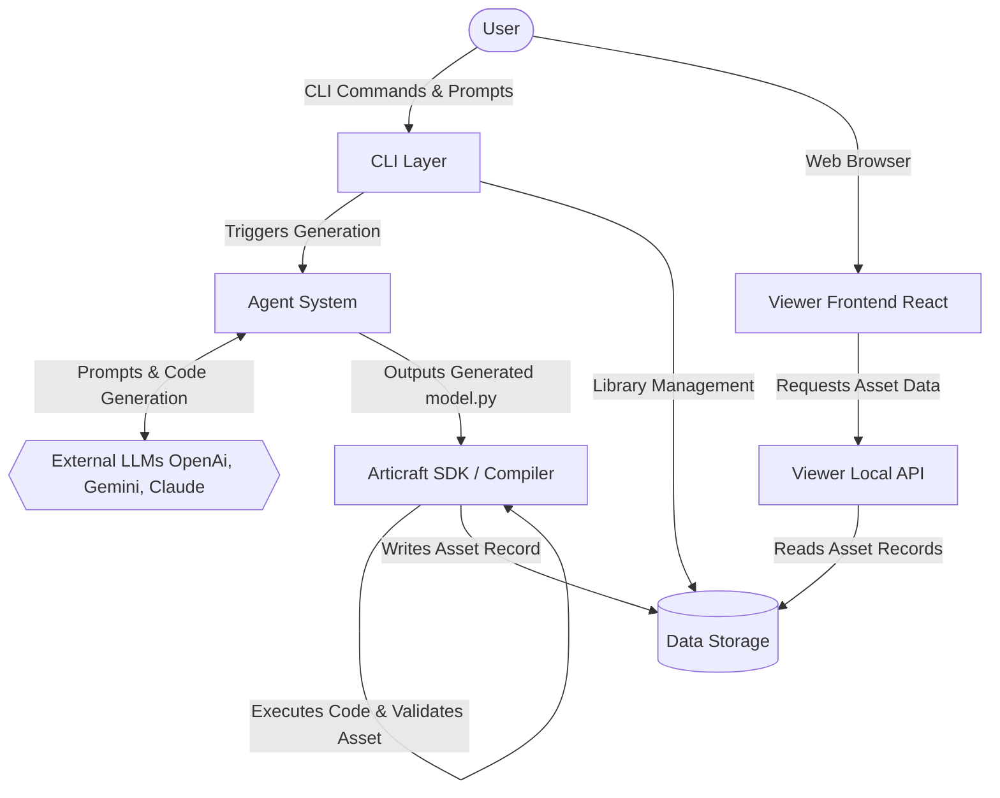

# Articraft System Architecture

> **Verification notes (2026-10-09).** The repository at `github.com/mattzh72/articraft` is **Apache-2.0** (contributed data: CC BY 4.0), but its README says it **has been superseded by `articraftresearch/Articraft`**, which is now maintained by a volunteer group. Use `articraftresearch/Articraft` for current code, and re-check that repository's license before reusing code. Top-level directories: `agent`, `articraft`, `cli`, `docs`, `plugins/articraft`, `scripts`, `sdk`, `storage`, `tests`, `viewer`. The README doesn't name the SDK's geometry backend; the paper says the SDK exposes CadQuery.

Articraft is an agentic system designed to scalable generate articulated 3D assets from textual prompts. It achieves this by acting as an orchestrator between external Large Language Models (LLMs), a local code compiler, and a robust visualization frontend. 

## Architectural Diagram

## Component Breakdown

The architecture is cleanly separated into several modular components:

### 1. Command Line Interface (CLI)
The `cli` module serves as the primary entry point for creators. It provides commands to initiate new generations (`articraft generate`), modify existing assets (`articraft fork`), and manage the local dataset library.

### 2. Agent System
Found in the `agent` and plugin directories, this layer translates user prompts into actionable instructions for external LLMs. It handles API authentication, prompt structuring, and context management to ensure the AI writes valid generation scripts.

### 3. Articraft SDK / Compiler
The core of the generation pipeline lives in the `sdk` and `articraft` core packages. When the LLM outputs a programmatic representation of a 3D object (typically a `model.py` script), this system acts as a compiler. It executes the Python code to programmatically construct the geometries, joints, and articulations, subsequently validating the output.

*Security Note:* Because this module runs dynamically generated Python scripts, it relies on the user running scripts from trusted sources or trusting the generated output of the respective LLMs.

### 4. Data Storage
Articraft uses a local file-system approach for storage (the `storage` module). Generated assets are saved as comprehensive "records" in a git-ignored directory (by default, `data/`). This allows the system to scale locally and track modifications over time.

### 5. Viewer (API & Frontend)
The `viewer` module contains both a backend API and a React-based frontend. It reads the compiled records from the Data Storage layer and renders the 3D assets in the browser, providing UI controls to manipulate the object's articulated joints and view its metadata.

---

**Further Reading:**
For an in-depth discussion of the research methodology, complex joint formulations, evaluation metrics, and the underlying algorithms powering this generation framework, please refer to Articraft.pdf.