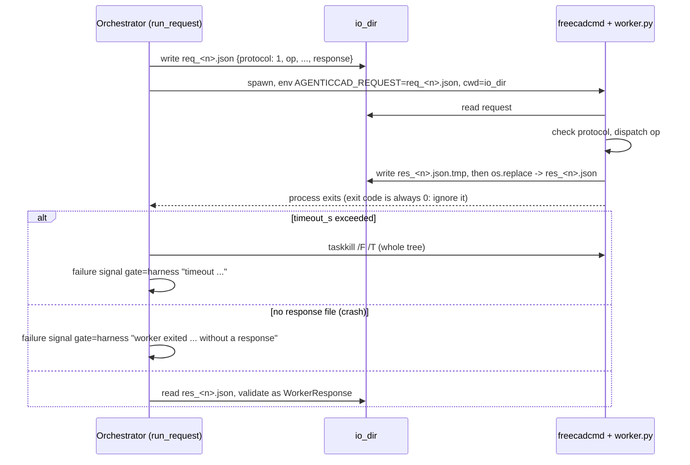

# Worker protocol v1 (frozen at P0 exit)

The orchestrator (uv venv, Python 3.12) never imports FreeCAD. Every FreeCAD operation runs in a fresh
`freecadcmd.exe` process (FreeCAD 1.1.4, Python 3.11) that exchanges one JSON request and one JSON response.
Code: `harness/run.py` (orchestrator), `harness/worker.py` (FreeCAD side), `harness/protocol.py` (schema).
Test: `tests/test_worker_protocol.py::test_protocol_v1_frozen_shape`.

## Request (`req_<n>.json`)

| Key | Type | Notes |
|---|---|---|
| `protocol` | int | `1`; added by `run_request`. A mismatch is refused with a failure signal |
| `op` | str | `ping`, `run_script`, `compile_part` (stub until P1) |
| `response` | str | absolute path of `res_<n>.json`; added by `run_request` |
| `timeout_s` | float | optional; default 60 |
| op-specific | any | `run_script`: `script` (path) plus any keys the script reads from `request` |

## Response (`res_<n>.json`): exactly these keys

| Key | Type | Notes |
|---|---|---|
| `protocol` | int | `1` |
| `ok` | bool | false if any failure signal was raised by the harness or the op |
| `op` | str \| null | echo of the request op |
| `signals` | list | `{level: failure\|warning\|info, gate, cause, location, action}`; exceptions become `failure` with the traceback in `location` |
| `artifacts` | dict[str, str] | e.g. `fcstd`, `step`, `stl` paths |
| `metrics` | dict | e.g. `volume_mm3`, `dof` |
| `result` | any | op payload (`run_script`: the `result` dict the script filled) |
| `freecad_version` | str | e.g. `"1.1.4"`; record in every job trace |
| `elapsed_s` | float | worker-side time |

`WorkerResponse` and `Signal` use `extra="forbid"`: an unknown key fails validation. To change the contract,
bump `PROTOCOL_VERSION` in both `harness/protocol.py` and `harness/worker.py` and update this file.

## freecadcmd facts the protocol relies on (T0.3, S10)
- Extra CLI args are opened as documents ⇒ the request path travels in `AGENTICCAD_REQUEST`.
- A script runs with `__name__` = file stem, not `"__main__"`; `run_script` execs with `__name__ = "__agenticcad_script__"`.
- Exit code is 0 even after an exception or a segfault ⇒ the response file is the only result channel.
- One process per request (cold start ≈ 1 s). A warm pool is a P2+ optimisation and must keep this contract.
