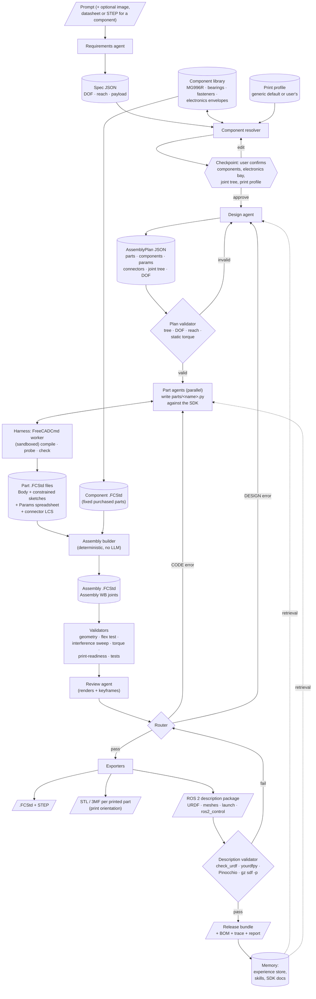
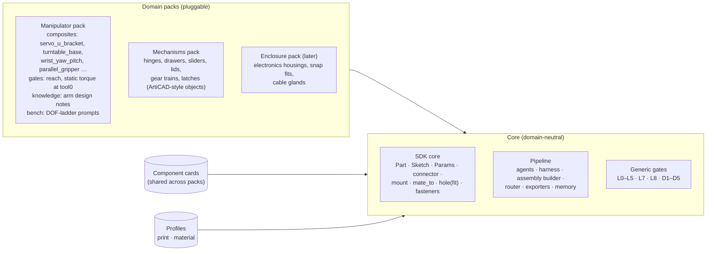
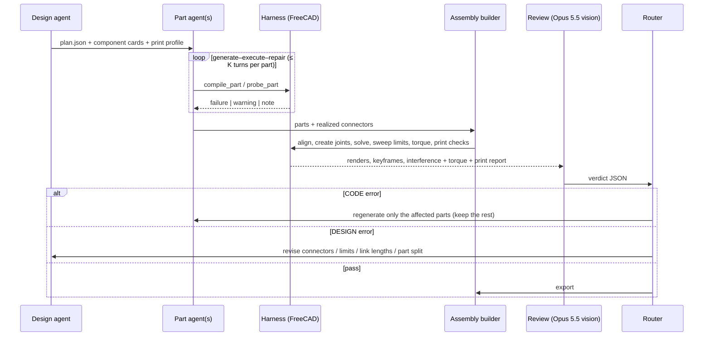
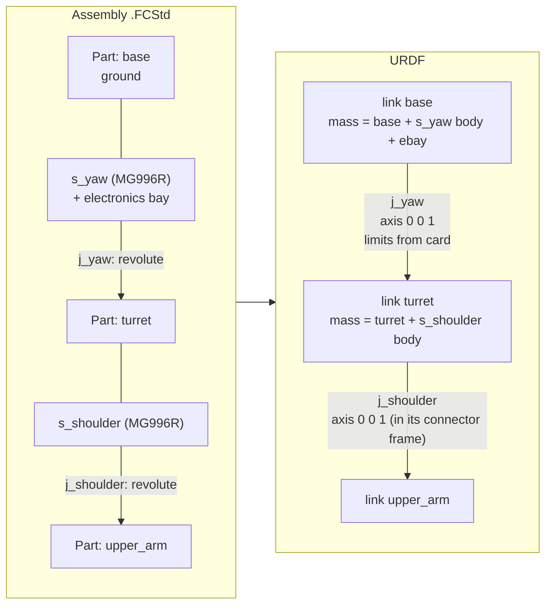
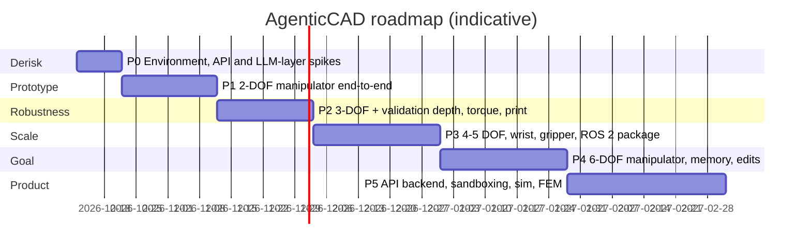

# AgenticCAD — Implementation Plan (draft v0.4, 2026-10-09)

> Location: `implementation_context/`. File paths in this plan are relative to the repository root. Status lives in `current_state.md`; per-phase detail lives in `phase_*.md`. FreeCAD pinned to **1.1.4** (bundled Python 3.11).

Goal: natural language (and later images) → **finished parametric CAD** (feature tree, constrained sketches, named parameters, assembly with typed joints) → **3D-printable parts** and a **URDF compatible with ROS 2 and Gazebo**. First target domain: **robot manipulators built from hobby servos**, from 2–3 DOF up to **6 DOF**. Every tool in the pipeline is open source and usable commercially; the LLM is Claude.

This is the prototype of a **potential commercial product**, so the plan aims for generality: no assumptions tied to one user, one printer or one set of parts. Everything specific lives in swappable profiles and component cards.

Primary references: **ArtiCAD** (Shui et al., 2026) and **Articraft** (Zhou et al., 2026). Supporting: CAD-Assistant (ICCV 2025), MEDA (IDETC 2025), Memory-Augmented RL Agent for CAD, Physics-in-the-Loop, and the research notes in `REFERECES/`.

> **The core synthesis.** ArtiCAD shows *what* to plan (connectors and a kinematic tree, decided before geometry) and gives us FreeCAD as a backend with a real feature tree and an assembly solver. Articraft shows *how* to make the LLM reliable: a small domain SDK, one writable program, a restricted action space, structured feedback, and authored tests. AgenticCAD = **ArtiCAD's planning and assembly contract, implemented through an Articraft-style SDK and harness, where the SDK emits native FreeCAD PartDesign features instead of meshes or dumb solids.**

### What changed in v0.4

| Input | Change in this plan |
|---|---|
| Q11–Q13 answered: targets as recommended, **gripper**, PETG default with PLA allowed | 6-DOF benchmark target fixed in §6.2 (250 mm reach, 50 g payload, stretch 100 g); SG90 parallel gripper is the standard end effector; MG90S card added for light wrist joints |
| "The robotic arm is just a benchmark; aim for generalization" | New §1.4 **Generality: core vs. domain packs**. Everything manipulator-specific (composites, torque/reach gates' defaults, design notes, benchmark prompts) moves into a pluggable *manipulator pack*. Every phase's benchmark now carries a non-manipulator slice |
| ArtiCAD architecture diagram (`Articad Architecture diagram.png`) analysed | New §1.5 mapping each block of the diagram onto this plan. Three gaps closed: **per-part render + VLM check** inside the part loop (L3v), a **per-component bbox table + joint-sweep GIF** as review input, and a **knowledge pack (design and connector guidance docs) available from Phase 1** instead of Phase 4 |

### What changed in v0.3

| Input | Change in this plan |
|---|---|
| R1/R2 report checked against FreeCAD source | Report corrected in `REFERECES/` (joints are `App::FeaturePython` + `JointObject.Joint`; limits are `EnableAngleMin`/`AngleMin`…; DoF is the `DoF` attribute; no `getUnderConstrainedElements`). Remaining unknowns listed in §6.1 |
| Agent SDK terms checked | Developing on your own subscription fits "ordinary individual use", but **a commercial product must use API-key authentication**, and running the Agent SDK inside a product has extra conditions. The LLM layer is now designed to move to the Claude API (§2.3) |
| No printer; stay general | Printer-agnostic **print profiles** with conservative defaults; nothing tuned to one machine (§4.2) |
| First tests 2–3 DOF manipulators, goal 6 DOF | Roadmap and benchmark rebuilt around a DOF ladder: 2 → 3 → 4–5 → 6 DOF (§6.4). New **static torque gate** so hobby servos aren't overloaded (§4.1, L6) |
| MG996R servos; leave room for electronics | MG996R card plus a generic **electronics bay** reserved when the user doesn't specify boards (§3.6) |
| Commercial intent | New §2.4 on product-level concerns: sandboxing generated code, licensing of outputs, profiles over hard-coding, regression benchmark |

---

## 1. Architecture overview

### 1.1 Components

| # | Component | LLM? | Role | Main source |
|---|---|---|---|---|
| 1 | **Requirements agent** | Opus 5.5 | Parse the prompt into a spec: DOF, reach, payload, workspace, parts, motions, **purchased components**, electronics, print profile | ArtiCAD §4.2 (requirement analysis + brainstorm module) |
| 2 | **Component resolver** | Opus 5.5 + library lookup | Match requested components to library cards, or draft new cards from a datasheet or STEP file. Reserve an electronics bay if none is given. **The user confirms the bill of components before generation** | New in this plan (§3.6) |
| 3 | **Design agent** | Opus 5.5 | Emit an `AssemblyPlan` (JSON): parts, parameters, **connectors**, joint tree, declared DOF, link lengths, placed components | ArtiCAD §4.1–4.2 |
| 4 | **Plan validator** | No | Schema, tree rooted at ground, DOF sum = declared D, connector references resolve, every actuated joint has a driver, **reach and static torque within limits** | ArtiCAD Eq. 1 and 4; this plan |
| 5 | **Part agents** (one per custom part, in parallel) | Sonnet 5.5 (escalate to Opus 5.5 on repeated failure) | Write `parts/<name>.py` against the **AgenticCAD SDK** in a restricted workspace | Articraft §3.1–3.2; ArtiCAD §4.3 |
| 6 | **Harness / CAD worker** | No | Sandboxed `FreeCADCmd` process: compile SDK program → `.FCStd`, run checks, return structured signals | Articraft §3.2; MEDA (executor) |
| 7 | **Assembly builder** | **No** | Align connector pairs deterministically and create FreeCAD Assembly joints | ArtiCAD §4.4 |
| 8 | **Validators** | No | Sketch/constraint, geometry, parametric robustness, interference over the joint range, static torque, print-readiness, authored tests | Articraft (QC + `run_tests`); this plan |
| 9 | **Review agent + router** | Opus 5.5 (vision) | Multi-view renders and joint keyframes → structured verdict; classify failures as **CODE** or **DESIGN** and route them | ArtiCAD §4.4–4.5 |
| 10 | **Exporters** | No | `.FCStd`, STEP, **STL/3MF per printed part**, **ROS 2 description package**, BOM | ArtiCAD §6; R3 report |
| 11 | **Description validator** | No | URDF parse, tree, inertia audit, mesh checks, Gazebo parse check, CAD↔URDF cross-check (no simulation run) | URDF validation note |
| 12 | **Memory** | Embeddings | Knowledge packs (design and connector guidance), experience store (Good / Issue cases), skills library | ArtiCAD §4.6; Memory-Augmented RL; ECIP composite ops |

### 1.2 Data flow



### 1.3 Artifacts per job

```
jobs/<job_id>/
  spec.json                 # requirements agent output (DOF, reach, payload, ...)
  bom.json                  # confirmed bill of components (servos, bearings, fasteners, electronics)
  print_profile.json        # profile used for this job (generic default or user's)
  plan.json                 # AssemblyPlan (the cross-stage contract)
  parts/<name>.py           # SDK programs (agent-writable, one per custom part)
  tests/assembly_tests.py   # authored assertions (Articraft-style)
  build/<name>.FCStd, build/assembly.FCStd, build/*.step
  print/<name>.3mf|.stl     # oriented for printing + print_report.json
  ros2/<robot>_description/ # urdf/, meshes/{visual,collision}/, launch/, config/
  renders/, report.json, trace.jsonl   # Articraft-style auditable trace
```

**Source of truth:** `plan.json` + `bom.json` + `parts/*.py`. The `.FCStd` they compile to is itself fully parametric and editable in FreeCAD, but GUI edits don't flow back to the agent.

### 1.4 Generality: a domain-neutral core plus domain packs

The 2→6-DOF manipulator is the **benchmark**, not the product scope. To keep it from leaking into the core, everything domain-specific is packaged as a *domain pack* that the core loads as data and plugins:



| Piece | Lives in | Why |
|---|---|---|
| Sketch, feature, parameter, connector, fastener and fit primitives | Core SDK | Every domain needs them |
| `servo_u_bracket`, `turntable_base`, `parallel_gripper`, … | Manipulator pack | Only make sense for arms; other packs bring their own composites |
| Static torque gate (L6) | Core, **generic over any actuated joint** with a card torque | A motorised lid or a pan-tilt head is checked the same way; only the `tool0`/payload defaults come from the manipulator pack |
| Reach check | Manipulator pack | Meaningless for a drawer |
| Design and connector guidance docs (RAG) | Per pack | Mirrors ArtiCAD's separate requirement-analysis and component/connector-analysis document stores |
| Benchmark prompts | Per pack | The suite reports results per pack, so manipulator gains can't hide regressions elsewhere |

Rules that keep the core honest:
- The core never imports a pack; packs register composites, gates, docs and prompts through an entry-point list.
- The requirements agent picks the pack(s) from the prompt; "no matching pack" falls back to core-only generation, which must still work (that is what the non-manipulator benchmark slice measures).
- A composite is promoted from a pack into the core only once two packs need it (e.g. `bearing_seat`, `horn_coupler`).

### 1.5 How this maps onto ArtiCAD's architecture diagram

Checked against `Articad Architecture diagram.png` (ArtiCAD Fig. 2):

| ArtiCAD block | In this plan | Difference and reason |
|---|---|---|
| User input: text **or** image example | Requirements agent; image input in Phase 4 | Same. Text first because the benchmark is text-driven |
| Design agent: requirement analysis → component and connector analysis → plan validation | Requirements agent → component resolver + **user checkpoint** → design agent → plan validator | We split it and add a checkpoint for purchased components, and plan-level torque and reach checks |
| Generation agent: code generation ⇄ code validation (syntax check → execution → render → **VLM judge**), one per part | Part agents + harness, gates L0–L4 and **L3v** (new in v0.4) | Same loop, but with deterministic sketch, geometry and flex gates *before* the VLM, because our output must be parametric, not only look right |
| Assembly agent: **deterministic assembly**; render images, adjust joint values and render GIFs, **each component's bbox** → LLM and VLM validation | Assembly builder (no LLM) + L5 sweep + L8 review | v0.4 adds the per-component bbox table and a joint-sweep GIF to the review input. Interference, torque and print gates are additions |
| Review agent: VLM **and rule-based** scoring; good/bad results feed the experience store | L8 + deterministic gates; release bundle and failed runs both written to memory | Deterministic gates decide pass/fail; the VLM can only add issues (risk 12) |
| Error handler, classifier and router spanning all agents | Router (CODE / DESIGN) | Same. Our router also receives description-gate (D1–D5) failures |
| RAG: requirement-analysis docs, component/connector-analysis docs, **FreeCAD documentation** | Knowledge pack per domain pack + **SDK reference** in the part agent's prompt | We don't give agents raw FreeCAD docs: they program against our SDK, whose reference is small enough to sit in context. FreeCAD docs are only for us when extending the SDK |
| Experience store: good cases / issue cases | §4.5 | Same asymmetric retrieval |

---

## 2. Tool and kernel choices

### 2.1 CAD kernel and modeling environment: **FreeCAD 1.x (PartDesign + Sketcher + Assembly) on OCCT**

| Option | License | Native feature tree? | Constrained sketches? | Assembly + joints? | Agent ergonomics | Verdict |
|---|---|---|---|---|---|---|
| **FreeCAD 1.x** | LGPL-2.1-or-later | **Yes** (PartDesign Body, document graph, `recompute`) | **Yes** (Sketcher, PlaneGCS solver) | **Yes** (Assembly WB in 1.0+, OndselSolver; Fixed, Revolute, Cylindrical, Slider, Ball, plus RackPinion, Screw, Gears, Belt couplings) | Verbose API, headless setup overhead, version churn | **Chosen**: the only option that meets the "Fusion/FreeCAD-style" definition natively |
| CadQuery | Apache-2.0 | No: a code chain, output is a solid | Partial (`Sketch` with a limited constraint set) | Placement constraints only; no joint types or kinematics (ArtiCAD §3) | Fluent chains, string selectors, high LLM error rate | Not the primary backend |
| build123d | Apache-2.0 | No: Python-level history only | No sketch constraint solver | Joints for placement only | Best typed Python API for LLMs | Optional fallback for complex geometry |
| OpenSCAD | GPL-2.0 | No (CSG) | No | No | Smallest error rate, but mesh output | Rejected: mesh/CSG output violates the goal |
| SolveSpace (lib `slvs`) | GPL-3.0 | Limited | Yes | Basic | Weak scripting API | Rejected: GPL linking risk, no part feature tree |

**Why FreeCAD.** The deliverable must be a feature tree with editable sketches, constraints and parameters. CadQuery and build123d are *parametric in code* only: their STEP output is a dumb solid. FreeCAD gives us what ArtiCAD relied on (§3: "FreeCAD combines sketch-based feature modeling with a constraint-based Assembly solver… CadQuery offers static placement but no joint types").

**Verified scripting surface** (corrected report in `REFERECES/`, checked against FreeCAD source):
- Assembly: `Assembly::AssemblyObject` → `Assembly::JointGroup` → joints as `App::FeaturePython` set up with `JointObject.Joint(obj, JointTypes.index("Revolute"))`; ground with `JointObject.GroundedJoint`; references `[obj, [element, vertex]]`; limits `EnableAngleMin/AngleMin/EnableAngleMax/AngleMax` and length equivalents; solve with `assembly.solve()` or a recompute.
- Sketcher: `solve()` returns 0 or an error code (−1 solver error, −2 redundant, −3 conflicting, −4 over-constrained, −5 malformed); `DoF`, `FullyConstrained`, `ConflictingConstraints`, `RedundantConstraints`, `PartiallyRedundantConstraints`, `MalformedConstraints`; `getGeometryWithDependentParameters()` for free geometry; `renameConstraint`, `setDatum`, `getDatum`, `autoconstraint`.

**Licensing.** FreeCAD runs as a separate, unmodified process (`FreeCADCmd`), so LGPL imposes no obligations on our code. OCCT is LGPL-2.1 with an additional exception.

**Trade-offs we accept and how we mitigate them:**
- *Verbose, error-prone raw API* → the LLM never sees it. It writes against our SDK (Articraft's central lesson).
- *Topological naming problem (TNP)* → the SDK attaches sketches to **datum planes and LCS objects** derived from parameters, never to generated faces.
- *Headless quirks and version churn* → pin one FreeCAD release (Docker image). Every recompute runs in a subprocess with a hard timeout. `JointObject` imports `pivy`, so the image must include it.

### 2.2 Full toolchain

| Concern | Choice | License | Alternatives considered | Why |
|---|---|---|---|---|
| CAD / feature tree | FreeCAD 1.x (`FreeCADCmd`) | LGPL-2.1+ | CadQuery, build123d, OpenSCAD | See 2.1 |
| Geometry kernel | OCCT (via FreeCAD) | LGPL-2.1 + exception | — | Exact B-rep |
| Sketch solver | FreeCAD Sketcher (PlaneGCS) | LGPL | SolveSpace (GPL-3) | Built in; full diagnostics |
| Assembly solver | FreeCAD Assembly WB (OndselSolver) | LGPL-2.1 (LICENSE confirmed in github.com/FreeCAD/OndselSolver, P0) | Assembly3 / Assembly4; our own SE(3) aligner | Native joints in the `.FCStd`; ArtiCAD uses it |
| Offscreen renders for review | PyVista on VTK | MIT / BSD-3 | FreeCAD GUI screenshots, Blender (GPL-2+, heavy) | Headless, scriptable cameras |
| Mesh processing and print checks | trimesh, manifold3d | MIT / Apache-2.0 | MeshLab (GPL) | Watertightness, wall-thickness rays, overhang analysis |
| 3MF export | lib3mf | BSD-2 | trimesh's 3MF writer | Standard printer format with units |
| Slicer check (optional gate) | PrusaSlicer or OrcaSlicer CLI | AGPL-3.0 | CuraEngine (AGPL-3.0) | Unmodified external executable only, never imported or linked |
| Static torque and FK | Pinocchio | BSD-2 | — | Gravity torques (RNEA) over sampled poses; inertia audit; FK cross-check |
| Collision geometry | Primitives first; CoACD when needed | MIT | V-HACD (BSD-3) | Keeps thin features better |
| URDF parse / tree checks | yourdfpy; `check_urdf` (urdfdom) | MIT / BSD-3 | urdfpy (unmaintained) | Strict parse |
| Gazebo compatibility check | `gz sdf -p` | Apache-2.0 | Full simulation run | Confirms Gazebo can read the model |
| URDF / ROS 2 package exporter | **Our own exporter** (lxml) | Ours (lxml is BSD) | CROSS, RobotCAD (both LGPL-2.1, verified) | We already hold connector frames and joint data; RobotCAD is the layout reference |
| Simulation (later, optional) | Gazebo (gz-sim), MuJoCo | Apache-2.0 / Apache-2.0 | PyBullet (zlib), Isaac Sim | Gazebo matches the stated target |
| Schemas | Pydantic | MIT | — | `AssemblyPlan`, `ComponentCard`, `PrintProfile`, feedback signals |
| Vector memory | FAISS or sqlite-vec | MIT / MIT+Apache | Chroma (Apache-2.0) | Small and embeddable |
| LLM orchestration | Claude Agent SDK (prototype) → Claude API with tool use (product) | Anthropic terms | LangGraph (MIT) | See 2.3 |
| Reused agent code | Articraft (`articraftresearch/Articraft`; the `mattzh72` original is Apache-2.0) | Apache-2.0 (re-check for the current repo) | — | Reuse with attribution in NOTICE |
| FEM (later) | FreeCAD FEM + CalculiX (subprocess) | LGPL / GPL-2 | torch-fem | Separate GPL executable does not affect our license |

### 2.3 LLM layer: Agent SDK for the prototype, built to move to the Claude API

**What the terms say** ([Claude Code legal and compliance page](https://code.claude.com/docs/en/legal-and-compliance), checked 2026-10-09; my reading, not legal advice):
- Subscription (OAuth) login is meant for "ordinary use of Claude Code and other native Anthropic applications", and the advertised Pro/Max limits "assume ordinary, individual usage of Claude Code and the Agent SDK".
- "Developers building products or services that interact with Claude's capabilities, including those using the Agent SDK, should use API key authentication." Third parties may not route requests through Free/Pro/Max credentials on behalf of their users.
- Running Claude Code (which the Agent SDK packages) inside a product requires the Commercial Terms, and "each end user must authenticate with their own Anthropic API key, Claude subscription plan credentials, or 3P inference provider credential". The product may not pay for or resell Claude usage on users' behalf.

**What that means for us:**
1. **Now (personal R&D):** running the prototype on your own subscription looks consistent with individual use. Heavy automated benchmark runs may exceed what "ordinary individual usage" limits allow, so expect throttling.
2. **Before anything customer-facing:** switch to an API key from Claude Console (or a cloud provider), under the Commercial Terms. This also makes cost per design measurable, which a product needs.
3. **Architecture choice for the product:** if the product runs the Agent SDK for customers, each customer must bring their own Claude credentials. If you want the company to pay for usage (a normal SaaS model), use the **Claude API directly with tool use** instead. That costs us little: we disable the Agent SDK's built-in tools anyway (Articraft's restricted action space), and all our tools are custom.
4. **Design rule:** agents talk to an internal `LLMBackend` interface with two implementations, `AgentSDKBackend` (prototype) and `ClaudeAPIBackend` (Messages API + tool runner). Tools are defined once as plain Python functions with JSON schemas and adapted to both.
5. Confirm the commercial model with Anthropic sales before launch; the policy page changed several times in 2026.

**Restricting the action space (Articraft §3.2).** Each agent session allows only our tools plus read/edit access to its own files. A permission check rejects writes outside `parts/<own_name>.py` and any shell, network or web tool. The exact SDK option names get confirmed in Phase 0.

**Model routing (initial; tuned by the benchmark):**

| Agent | Model | Why |
|---|---|---|
| Requirements, component resolver, design | Opus 5.5 | Spatial and structural reasoning; few calls per job |
| Part agents | Sonnet 5.5, escalate to Opus 5.5 after K failed iterations | Many parallel calls; the SDK carries most of the difficulty |
| Review (vision) | Opus 5.5 | Image judgment of renders and keyframes |
| Router | Sonnet 5.5 | Classification of structured feedback |

### 2.4 Product-level concerns (commercial intent)

| Concern | Decision |
|---|---|
| **Running LLM-generated code** | Every part program runs in a locked-down container: no network, read-only SDK, CPU/memory/time limits, only the job folder writable. The L0 lint is a convenience, not the security boundary |
| **Generality** | No hard-coded printer, servo or board. Print profiles, component cards and electronics envelopes are data. The SDK is domain-general; manipulators only decide which composites come first |
| **Licensing of outputs** | Generated FCStd/STEP/STL/URDF are our data outputs, not derivative works of LGPL tools (R3). Component geometry is our own, modeled from public datasheet dimensions; no vendor CAD is redistributed. A license audit (`pip-licenses`) runs in CI |
| **Reproducibility** | Each job stores model IDs, prompts, tool versions, FreeCAD version and hashes (Articraft trace logging) |
| **Quality bar** | Regression benchmark in CI; a release must not lower success rate, DoF = 0 rate, flex pass rate or torque-margin pass rate |
| **Cost** | Per-job token and cost accounting from day 1 (a product needs a cost per design) |
| **Safety of physical outputs** | Reports state the assumptions (servo torque derating, printed mass model, material) and never present the URDF dynamics as measured values |

---

## 3. How the agent represents and edits CAD

### 3.1 Decision: code generation against a domain SDK that emits native FreeCAD features

| Approach | Used by | Pros | Cons |
|---|---|---|---|
| Raw FreeCAD Python generation | ArtiCAD (per-part scripts), CAD-Assistant (actions as Python) | Full power | Large API surface leads to hallucination; TNP-fragile; hard to guarantee constraints |
| Stepwise tool or API calls on live CAD state | CAD-Assistant (planner → action → env feedback) | Good for interactive edits and inspection | Long trajectories; state drift; harder to reproduce |
| **Program against a narrow SDK + harness** | **Articraft** (`model.py`, `ArticulatedObject`, `run_tests`) | Compact, testable, reproducible, cheap | SDK must be built and maintained |

**Chosen:** the Articraft pattern for *authoring*, ArtiCAD's connector contract for *assembly*, and CAD-Assistant-style probe tools for *inspection and edits*.

### 3.2 The AssemblyPlan (ArtiCAD connector contract)

ArtiCAD Eq. 2 and Eq. 4: connector `c = (n, o, ẑ, x̂, l)` and plan `P = ({p_i}, {j_k}, g, D)`. Components (purchased parts) and a **driver** on actuated joints are additions.

```json
{
  "units": "mm",
  "ground": "base",
  "requirements": { "dof": 2, "reach_mm": 220, "payload_g": 50 },
  "params": { "upper_arm_len": 110, "forearm_len": 110 },
  "components": [
    { "id": "s_yaw",      "card": "servo/mg996r", "attach_to": "base.yaw_servo_mount" },
    { "id": "s_shoulder", "card": "servo/mg996r", "attach_to": "turret.shoulder_servo_mount" },
    { "id": "ebay",       "card": "electronics/generic_bay", "attach_to": "base.ebay_mount" }
  ],
  "parts": [
    { "name": "base",       "material": "PETG", "intent": "round base, houses s_yaw and the electronics bay",
      "connectors": [ { "name": "yaw_servo_mount", "o": [0,0,8], "z": [0,0,1], "x": [1,0,0], "label": "servo_mount" },
                      { "name": "ebay_mount",      "o": [0,-40,3], "z": [0,0,1], "x": [1,0,0], "label": "electronics" } ] },
    { "name": "turret",     "material": "PETG", "intent": "rotating turret with a U-bracket for s_shoulder and an idler bearing",
      "connectors": [ { "name": "yaw_horn", "o": [0,0,0], "z": [0,0,1], "x": [1,0,0], "label": "servo_horn" },
                      { "name": "shoulder_servo_mount", "o": [0,0,45], "z": [0,1,0], "x": [1,0,0], "label": "servo_mount" } ] },
    { "name": "upper_arm",  "material": "PETG", "intent": "link with horn interface and bearing pin",
      "connectors": [ { "name": "shoulder_horn", "o": [0,0,0], "z": [0,1,0], "x": [1,0,0], "label": "servo_horn" } ] }
  ],
  "joints": [
    { "name": "j_yaw",      "type": "revolute", "parent": "s_yaw.output_shaft",      "child": "turret.yaw_horn",
      "driver": "s_yaw",      "limits": { "lower": -1.57, "upper": 1.57, "effort": "from_card", "velocity": "from_card" } },
    { "name": "j_shoulder", "type": "revolute", "parent": "s_shoulder.output_shaft", "child": "upper_arm.shoulder_horn",
      "driver": "s_shoulder", "limits": { "lower": -0.2, "upper": 2.6, "effort": "from_card", "velocity": "from_card" } }
  ],
  "derived": [],
  "dof": 2
}
```

- Joint types: `fixed | revolute | slider | cylindrical | ball` (ArtiCAD Fig. 3), plus `continuous`, and **coupled joints** (`gears`, `rack_pinion`) for grippers, exported to URDF as `<mimic>` (§5.1).
- **Kinematic tree only** (ArtiCAD §3; no closed loops needed).
- **Derived parts** (mirror, pattern) use a deterministic SE(3) transform of a source part (ArtiCAD §4.2), e.g. mirrored gripper fingers.
- Part generations are conditionally independent given the contract (ArtiCAD Eq. 3), so part agents run in parallel and repairs stay targeted.

### 3.3 The AgenticCAD SDK (Articraft-style, FreeCAD-native output)

Design rules:
1. **Every SDK call creates a real FreeCAD feature.** No `Part::Feature` dumb solids unless the build123d escape hatch is used.
2. **Parameters are symbolic.** `Param` objects compile to FreeCAD **expressions** bound to a `Params` spreadsheet, with explicit units. Values stay live in the `.FCStd`.
3. **Sketch helpers emit fully constrained geometry**, with named dimensional constraints bound to params (`renameConstraint` + expression binding). The SDK guarantees DoF = 0.
4. **Attach to datums, not faces** (TNP mitigation).
5. **Connectors are `App::LocalCoordinateSystem` objects** whose placement is an expression of params (ArtiCAD §4.3).
6. **Typed, self-describing signatures** (ECIP idea) and a small surface: about 30 calls in v1.
7. **Component-aware helpers.** `part.mount("s_shoulder", at="shoulder_servo_mount")` cuts the card's mounting pattern, body pocket and cable exit. `part.mate_to("s_shoulder.horn")` cuts the horn interface. The LLM never re-derives an MG996R's hole pattern.
8. **Print-aware helpers.** `hole(d, fit="clearance"|"press"|"tap_m3"|"insert_m3")` takes clearances from the active print profile, never from literals. `boss(...)` and `rib(...)` respect the profile's minimum wall.
9. **Manipulator composites first** (generic enough for other robots): `servo_u_bracket` (servo on one side, idler bearing on the other so the servo shaft isn't the only support), `horn_coupler`, `bearing_seat`, `turntable_base` (thrust support for a yaw joint), `link_bar` / `hollow_link` (with a cable channel), `wrist_yaw_pitch`, `parallel_gripper` (rack-pinion or gear-coupled fingers), `electronics_bay`. Validated new composites are promoted over time (Memory-Augmented RL "skills").
10. **Reuse Articraft code where licenses allow.** Test-context helpers (`expect_contact`, `allow_overlap`, …), feedback formatting and harness patterns, with attribution. Its CadQuery geometry layer is not reused, because ours must emit FreeCAD features.

Example `parts/upper_arm.py`:

```python
from agenticcad import Part, Params

def build(P: Params) -> Part:
    part = Part("upper_arm", material="PETG")
    p = part.params(length=P.upper_arm_len, width=28, thick=6)

    s = part.sketch("profile", on=part.datum("XZ"))
    s.slot(start=(0, 0), end=(p.length, 0), width=p.width)   # fully constrained, dims named
    part.pad(s, length=p.thick)

    part.mate_to("s_shoulder.horn", at=(0, 0, 0))              # horn screw pattern from the MG996R card
    part.mount("s_elbow", at=(p.length, 0, 0))                 # next servo pocket at the elbow
    part.cable_channel(start=(0, 0), end=(p.length, 0))

    part.connector("shoulder_horn", origin=(0, 0, 0), z=(0, 1, 0), x=(1, 0, 0), label="servo_horn")
    return part
```

Assembly-level tests (Articraft `run_tests`):

```python
def run_tests(ctx):
    ctx.expect_contact("upper_arm", "s_shoulder", near="horn")
    ctx.expect_clearance("upper_arm", "turret", min_mm=1.0, over_joint="j_shoulder", samples=9)
    ctx.expect_reach(">=", 220, frame="tool0")
    ctx.allow_overlap("s_shoulder", "turret.servo_pocket", reason="component seated in pocket")
```

### 3.4 Restricted workspace and action space (Articraft §3.2, Table 2)

Each part agent sees only `parts/<name>.py` (writable), the plan excerpt, component cards and print profile for its part (read-only), SDK docs and examples (read-only), and these tools:

| Tool | Edits? | Purpose |
|---|---|---|
| `read_file` | No | SDK docs, component cards, its own program |
| `apply_patch` / `write_file` | Yes | Only its own part file |
| `find_examples(query)` | No | Curated snippets plus Good cases from memory |
| `compile_part()` | No | Run in the sandboxed FreeCAD worker, run baseline QC, return `failure / warning / note` signals |
| `probe_part(snippet)` | No | Read-only measurement (bbox, distances, connector pose, sketch DoF, wall thickness) as JSON |
| `render_part(views)` | No | PyVista views, used sparingly |

No shell or network access. Hard caps on turns, tokens and wall time per part.

### 3.5 Editing existing models

- **Parameter edits** ("make the forearm 20 mm longer") → change params → deterministic recompile, then re-run the torque gate.
- **Feature edits** ("add a cable channel to the forearm") → that part's agent only (targeted repair, ArtiCAD §4.5).
- **Structural edits** ("add a wrist roll joint") → Design agent revises the plan; unaffected parts stay in the *keep* pool.
- **Component swaps** ("use a stronger servo at the shoulder") → change `bom.json`, re-run the checkpoint, re-plan only the parts that mount that component.

### 3.6 Component library, electronics bay and pre-generation checkpoint

A purchased component is a part whose geometry and connectors are known in advance, which fits ArtiCAD's rule of fixing interfaces before generating geometry.

**Component card** (`components/<family>/<id>.yaml` + a FreeCAD generator script):

```yaml
id: servo/mg996r
kind: actuator.servo
source: public datasheet dimensions; verified: false   # becomes true after measuring physical samples
variants_note: many MG996R clones differ by ~0.5 mm; interface features use the profile's clearance
envelope_mm: { body: [40.7, 19.7, 42.9], flange_span: 54.6 }   # nominal; confirm against samples
mass_kg: 0.055
actuation:
  type: revolute
  range_deg: [-90, 90]                   # typical; many units travel ~180° total
  stall_torque_Nm: { at_4_8V: 0.94, at_6V: 1.08 }   # datasheet values; verify per supplier
  speed_rad_s: { at_4_8V: 6.0, at_6V: 7.0 }        # approx.
  derating: 0.5                          # design to ≤50% of stall torque by default
electrical: { voltage_V: [4.8, 7.2], stall_current_A: 2.5 }   # approx.; used to size the power note
connectors:
  body_mount:   { o: [0,0,0],     z: [0,0,1], x: [1,0,0], label: servo_mount }
  output_shaft: { o: [shaft_x,0,spline_top], z: [0,0,1], x: [1,0,0], label: servo_horn }   # P0: values name params_mm entries; frame = flange underside (see components/servo/mg996r.yaml)
interfaces:
  mount_holes: { pattern: rect, pitch: [49.5, 10], d_clearance: 4.2 }
  output_spline: { teeth: 25 }
  keep_out: [ { box: [...], reason: cable exit } ]
model: generators/servo_mg996r.py   # simplified envelope + exact interface features
```

Card rules:
- **Geometry is ours.** Envelope plus exact interface features, generated by our own script from public dimensions. No vendor CAD is redistributed, which keeps the product's licensing clean.
- **Every card has a `verified` flag.** Drafted or unverified cards are always shown at the checkpoint. MG996R clones vary, so verify the card against physical samples before relying on tight fits.
- **Actuated joints take their limits from the card.** URDF `effort` = stall torque × derating; `velocity` from the speed spec; joint axis = `output_shaft` connector.
- **New components** can be drafted from a datasheet or a user-supplied STEP file (used as a fixed, non-parametric envelope), always confirmed at the checkpoint.

**Electronics bay (when the user doesn't specify electronics).** The resolver adds a `electronics/generic_bay` component: a keep-out volume with a mounting plate and standoffs, placed in the base by default.

| Property | Default | Why |
|---|---|---|
| Usable volume | 75 × 60 × 25 mm | Fits common controller boards (Arduino Uno-size 68.6 × 53.4 mm, ESP32 dev boards) or a 16-channel PWM servo driver (~62 × 25 mm) |
| Mounting | Slotted standoff pattern rather than one board's hole pattern | Stays generic until a board is chosen |
| Openings | Cable exit toward the arm, one external connector cut-out, ventilation slots | Wiring and heat |
| Power note | The report states the servos' combined stall current (≈2.5 A each, approximate) and recommends an external supply | Six MG996R servos can draw far more than USB or a board regulator provides |

If the user names a board ("ESP32 DevKit + PCA9685"), the resolver swaps the generic bay for those boards' cards and their exact hole patterns.

**Seed library (Phases 1–3):** MG996R (main actuator), MG90S (light wrist joints), SG90 (gripper), servo horns, 608ZZ / 623ZZ / 6806 bearings, M2.5 / M3 / M4 screws and nuts, M3 heat-set inserts, generic electronics bay, Arduino Uno-size, ESP32 DevKit and PCA9685 board envelopes.

**Checkpoint** (shown before generation; the only human step by default):
- bill of components with quantities and verified/drafted status;
- the joint tree in plain language ("s_shoulder drives the upper arm: −11° to 150° about the turret's Y axis");
- requirements check: estimated reach and the worst-case static torque per joint vs. derated servo torque (from link-length estimates);
- print profile in use (generic default or the user's).

---

## 4. Validation and self-correction loop

### 4.1 Layered gates (cheap and deterministic first, VLM last)

| Layer | Check | Tooling | On failure, route to |
|---|---|---|---|
| L0 Static | AST lint: only SDK imports, no I/O, no banned calls; type check | `ast`, mypy | Part agent (CODE) |
| L1 Execute | Compile in the sandboxed FreeCAD worker with a timeout; no objects invalid after recompute | FreeCAD | Part agent (CODE) |
| L2 Sketch / constraints | `solve()` == 0, `DoF` == 0, empty `Conflicting` / `Redundant` / `PartiallyRedundant` / `Malformed` lists; free geometry from `getGeometryWithDependentParameters()`; every dimension driven by a `Params` expression or marked fixed | Sketcher diagnostics (verified API) | Part agent (CODE) |
| L3 Geometry | Valid shape, one solid per Body, volume > 0, bbox vs. spec within tolerance, connectors within ε of their intended surface or axis | OCCT via FreeCAD | Part agent (CODE) |
| **L3v Part look check** (new in v0.4, from ArtiCAD's per-part VLM judge) | After L0–L3 pass: 4 renders of the single part with connector frames drawn, plus its intent string → Sonnet 5.5 vision answers a fixed checklist (matches intent? connectors on the right faces? obviously missing features?). Runs once per accepted candidate, not on every turn | PyVista + Claude vision | Part agent (CODE); never blocks on its own after 2 disagreements, it records a warning instead |
| **L4 Parametric robustness ("flex test")** | Perturb each top-level parameter within its declared range and recompute: no errors, sketches stay DoF = 0, connectors still valid | FreeCAD | Part agent (CODE), or Design agent if ranges conflict |
| L5 Assembly | Deterministic alignment succeeds; Assembly WB solves; **interference** at rest and at N samples across each joint's limits (servos and electronics bay included); authored `run_tests`; **reach** meets the spec | FreeCAD Assembly + OCCT booleans + FK | Router: CODE if one part is mis-sized, DESIGN if connectors, limits or link lengths are wrong |
| **L6 Static torque** | For sampled poses across the joint limits, with the specified payload at the tool frame: gravity torque at every actuated joint ≤ stall torque × derating. Uses printed masses (§5.3) and component masses | Pinocchio (RNEA with zero velocity and acceleration) | DESIGN: shorten links, lighten parts, move servos closer to the joint, or flag that the servo is undersized |
| **L7 Print-readiness** | See §4.2 | trimesh, manifold3d, optional slicer CLI | Part agent (CODE), or Design agent if a part must be split |
| L8 Visual review | Multi-view renders + **a joint-sweep GIF per actuated joint** (or its keyframes) + **a per-component bbox table** (size, position, which link it belongs to; ArtiCAD's assembly validation input) + the deterministic gate reports → Opus 5.5 gives a structured JSON verdict (Geometry, Detail, Motion, 1–5, with reasons) | PyVista + Claude vision | Router (CODE / DESIGN) |
| L9 Description | See §5.4 | check_urdf, yourdfpy, Pinocchio, `gz sdf -p` | Exporter bug, or DESIGN |

Sources: L1/L3/L5 baseline QC and authored tests from Articraft §3.1; interference and VLM review from ArtiCAD §4.3–4.4; constraint checks from CAD-Assistant; L6 is a static, lightweight version of Physics-in-the-Loop's idea of using engineering checks as feedback. L4, L6 and L7 are new in this plan.

**Why L6 matters for this domain.** A 6-DOF arm on MG996R servos is torque-limited at the shoulder. A rough estimate: a 200 g load at 300 mm already needs about 0.6 N·m, more than half of an MG996R's ~1.1 N·m stall torque at 6 V, before counting the arm's own mass. The design agent has to know this early, so L6 also runs on the *plan* (with estimated masses) before any part is generated.

### 4.2 Print-readiness gate (printer-agnostic)

There is no target printer. The pipeline ships a **generic FDM profile** with conservative defaults that most consumer printers can meet, and a user or customer can replace it with their own profile.

| Profile field | Generic default | Notes |
|---|---|---|
| Build volume | 180 × 180 × 180 mm | Fits nearly all current consumer FDM printers; larger parts get split |
| Nozzle / layer | 0.4 mm / 0.2 mm | Most common configuration |
| Minimum wall | 1.2 mm (3 perimeters) | |
| Max unsupported overhang | 45° from vertical; bridges ≤ 10 mm | |
| Clearances | sliding 0.3 mm per side, press 0.1 mm, horizontal holes +0.2 mm | Fits stay printable on uncalibrated printers |
| Heat-set inserts | per insert card | |
| Material | PETG default (PLA allowed) | Density and strength per material table |

Checks (all against the active profile):

| Check | How |
|---|---|
| Fits the build volume in the chosen orientation; otherwise the Design agent splits the part with a joint feature (dovetail, screws) | Oriented bbox |
| Print orientation with minimum support area, keeping marked load paths in-plane (layer lines are weak under tension) | Candidate orientations scored on overhang and contact area |
| Minimum wall and minimum feature size | Ray-cast thickness on the mesh |
| Overhangs and bridges | Face normals in print orientation |
| Fits and clearances | Enforced by SDK `hole(fit=...)`; verified by probes |
| Watertight, manifold | trimesh / manifold3d |
| Slicer check (optional) | PrusaSlicer or OrcaSlicer CLI with a generic printer config: slices without errors, reports filament mass and time |

Profiles for other processes (resin, SLS) can be added later as data.

### 4.3 Structured feedback

Articraft returns `failure / warning / note`, not raw logs; ECIP adds *cause / location / corrective action*:

```json
{ "level": "failure", "gate": "L6", "joint": "j_shoulder",
  "cause": "static torque 0.71 N·m > allowed 0.54 N·m (MG996R stall 1.08 N·m × 0.5) at q=[0, 0.0, 0.0]",
  "location": "plan.params.upper_arm_len, plan.params.forearm_len",
  "action": "shorten upper_arm_len + forearm_len by ~25%, or move the elbow servo to the base with a belt/linkage, or choose a stronger servo",
  "evidence": { "payload_g": 100, "arm_mass_g": 210 } }
```

### 4.4 Router and rollback (ArtiCAD §4.5)



Budgets: at most K part iterations (start at 5, matching ArtiCAD's baseline), one escalation from Sonnet 5.5 to Opus 5.5 per part, at most 2 design rollbacks, a per-job turn cap. On exhaustion, return the best candidate with its open failures listed, never a silent pass.

### 4.5 Knowledge and memory

- **Knowledge pack (from Phase 1, static).** Each domain pack ships short curated documents for the two design stages, matching ArtiCAD's RAG split: *requirement analysis* (what to ask and infer, typical dimensions and ratios) and *component and connector analysis* (how parts usually connect: horn couplers, bearing-supported pivots, hinge pins, slides). At first they are small enough to put straight into the prompt; retrieval is added only when they outgrow it. The part agent gets the **SDK reference** instead of FreeCAD docs.
- **Experience store** with Good and Issue cases and asymmetric retrieval: the Design agent reads both, part agents only Good cases (ArtiCAD §4.6). ArtiCAD reports fewer iterations with the store: 3.1 vs. 4.4 average (Table 2).
- **Skills library**: validated composite SDK functions (Memory-Augmented RL; ECIP).
- **Component library growth**: drafted cards that users approve become library entries.

---

## 5. URDF pipeline (ROS 2 and Gazebo compatible)

### 5.1 Mapping CAD to URDF



| URDF element | Derived from |
|---|---|
| `<link>` | One rigid group: a printed part plus every component and fastener fixed to it. A servo's body belongs to the link it is mounted on; its horn belongs to the driven link |
| Link frame | Root link: base part origin. Child link: **its joint connector frame**, so every joint has `axis="0 0 1"` and a clean origin |
| `<joint type>` | `revolute`→`revolute` (or `continuous` with no limits), `slider`→`prismatic`, `fixed`→`fixed`. `cylindrical` → prismatic + revolute via a massless intermediate link. `ball` → three revolute joints via two intermediate links. **Coupled joints** (`gears`, `rack_pinion`, e.g. a gripper's second finger) → the follower joint gets `<mimic joint="..." multiplier="..." offset="..."/>` |
| `<origin>` of joint | Pose of the parent connector in the parent link frame, from the solved assembly at q = 0 |
| `<limit>` | Range from the plan; `effort` = card stall torque × derating; `velocity` from the card |
| `<inertial>` | Printed parts: B-rep volume, centre of mass and inertia from OCCT, scaled to the *printed* mass (§5.3). Components: card mass, inertia approximated from the card envelope. Combined per link (parallel-axis theorem) at the link COM |
| `<visual>` | Tessellation in link-frame coordinates, mm→m; `.dae` (with colour) or `.stl` |
| `<collision>` | Primitive (box or cylinder) when the solid fits within tolerance; otherwise CoACD hulls (count capped) |
| Mesh URIs | `package://<robot>_description/meshes/...` |
| Tool frame | A fixed `tool0` link at the end effector (ROS-Industrial convention), used by the reach and torque checks |

### 5.2 Exporter: our own, with RobotCAD as the reference

CROSS and RobotCAD are both LGPL-2.1 (verified on their repository pages). Both are built around the FreeCAD GUI. RobotCAD's `ros2_controllers` generation is listed under an "External Extended Code Generator" whose openness we haven't checked. We keep our own exporter because every input it needs already exists as data in our pipeline. RobotCAD's generated packages serve as the reference for layout and `ros2_control` conventions in Phase 3.

### 5.3 Mass of printed parts

A printed part is not solid plastic, so `density × CAD volume` overstates its mass:
- **Default:** printed mass ≈ density × (shell volume from wall count and top/bottom layers + infill fraction × the remaining interior). Inertia = solid tensor × (printed mass / solid mass). The centre of mass stays exact; the tensor is approximate.
- **With the slicer gate:** use the slicer's reported filament mass for the scale factor.

The same masses feed the L6 torque gate. The report states the method used for each link.

### 5.4 Description checks in the loop (no simulation run)

| Gate | Test | Tool | Pass criterion |
|---|---|---|---|
| D1 Syntax / tree | Parse; single root; no cycles; all `package://` paths resolve; required tags present; mimic targets exist | `check_urdf`, yourdfpy | No errors or warnings |
| D2 Inertia | Each link: mass > 0; inertia positive-definite; triangle inequality. System: joint-space inertia matrix PD at sampled q | Pinocchio | All hold |
| D3 Meshes | Watertight visual meshes or explicit exemption; collision hull count ≤ cap; metres | trimesh | All hold |
| D4 Gazebo parse | `gz sdf -p robot.urdf` converts without errors | gz-sim tools | Converts cleanly |
| **D5 FK cross-check** | For M random q within limits: link poses from Pinocchio vs. the FreeCAD Assembly solved at the same joint values | Pinocchio + FreeCAD | Position error < 1e-5 m, rotation error < 1e-4 rad |

### 5.5 The ROS 2 description package

```
<robot>_description/
  package.xml, CMakeLists.txt        # ament_cmake
  urdf/<robot>.urdf                  # plain URDF (xacro wrapper optional)
  meshes/visual/*.dae|stl  meshes/collision/*.stl
  launch/display.launch.py           # robot_state_publisher + joint_state_publisher_gui + RViz
  launch/gazebo.launch.py            # spawn into gz-sim (ros_gz_sim)
  config/ros2_controllers.yaml       # joint_trajectory_controller for the arm, when actuated joints exist
```

- `<ros2_control>` block for servo-driven joints, with position command interfaces and the `gz_ros2_control` plugin for Gazebo. Phase 3 onwards.
- Phase 3 smoke test, outside the agent loop: `colcon build` and `ros2 launch <robot>_description display.launch.py` in a ROS 2 Docker image.
- A MoveIt configuration is a natural later addition for 6-DOF arms, not in scope yet.

### 5.6 Simulation later (optional)

Gazebo spawn with `ros2_control` and a gravity hold test, plus optional MuJoCo gates. Failures become structured feedback through the same router.

---

## 6. Risks, open questions and roadmap

### 6.1 Risks

| # | Risk | Impact | Mitigation |
|---|---|---|---|
| 1 | **Remaining unverified FreeCAD details** (after correcting the R1/R2 report): importing `JointObject` headless (needs `pivy`); referencing an LCS inside an `App::Part` as a joint reference; how to drive a joint to a given angle (likely `Offset2`); whether `Placement1/2` are local or global; constraint expression path syntax | Phase 1 blocked | Phase 0 tests each one; fallback is our own SE(3) aligner that writes placements and joint metadata |
| 2 | Headless recompute can hang without raising | Stuck jobs | Subprocess with a hard timeout around every recompute; re-read shapes after each recompute |
| 3 | **Hobby servos are undersized for 6 DOF** | Arms that can't lift themselves | L6 torque gate on the plan and on the final model; design strategies in the composite library (short links, servos near the base, counterweights, idler bearings); the report states margins honestly |
| 4 | MG996R clones vary in dimensions and torque | Printed parts don't fit; torque lower than datasheet | `verified` flag; measure samples before trusting cards; derating 0.5 by default; clearances from the profile |
| 5 | LLM-authored sketches under- or over-constrained | Not parametric | Constrained-by-construction SDK helpers; L2 gate |
| 6 | TNP breaks edits after parameter changes | Silent wrong geometry | Datum-based attachment; L4 flex test |
| 7 | Generic print profile too conservative or not conservative enough | Heavier parts, or failed prints on some printers | Defaults chosen for broad compatibility; user profiles override; optional slicer gate |
| 8 | Printed mass and inertia are approximate | Torque gate and URDF dynamics are off | Shell + infill model; slicer mass when available; method stated in the report |
| 9 | **LLM terms for a commercial product** | Can't ship on subscription auth | Prototype on your subscription; switch to API key before anything customer-facing; `LLMBackend` interface so the product can run on the Claude API directly (§2.3) |
| 10 | Agent SDK built-in tools bypass the restricted action space | Agents edit the wrong files or run commands | Tool allow-list and permission check; tests for the check |
| 11 | Running LLM-generated Python in a product | Security incident | Locked-down container per job (no network, limits, read-only SDK) (§2.4) |
| 12 | VLM judge is noisy (ArtiCAD's inter-judge Krippendorff α = 0.58–0.64) | Unstable accept/reject | Deterministic gates decide pass/fail; the review can only add issues |
| 13 | License contamination | Commercial blocker | GPL/AGPL tools only as separate executables; LGPL code copied from CROSS/RobotCAD stays in LGPL files; Articraft attribution; CI license audit |
| 14 | No ground-truth benchmark | Can't measure progress | Our own manipulator-first suite with deterministic metrics + rubric (§6.4) |

### 6.2 Decisions on Q11–Q13 (benchmark targets)

These are **benchmark targets**, stored in the manipulator pack's bench config, not constants in the code.

| | Decision |
|---|---|
| **Q11 Reach and payload (6-DOF)** | **250 mm reach** (yaw axis to gripper fingertip centre, arm fully extended horizontally) with a **50 g payload** at that reach, with every joint within stall × 0.5. **Stretch:** 100 g payload, at whatever reach still passes. 2- and 3-DOF steps use 150 mm and 200 mm |
| **Q12 End effector** | **SG90-driven parallel gripper** with gear-coupled fingers (`<mimic>` in URDF), ≥ 40 mm jaw opening. The gripper is a manipulator-pack composite; a tool flange stays available as an alternative |
| **Q13 Material** | **PETG default**, PLA allowed through the material table; the print profile records which one was used |

**Why the 6-DOF target is hard, and is a good benchmark.** A rough shoulder budget at 250 mm with the arm horizontal (estimates, to be replaced by L6's computed values):

| Load on the shoulder | Mass | Lever arm | Torque |
|---|---|---|---|
| Payload | 50 g | 0.25 m | 0.12 N·m |
| Gripper (SG90 + printed parts) | ~60 g | 0.24 m | 0.14 N·m |
| Wrist servos (MG996R pitch + MG90S roll) | ~70 g | 0.19 m | 0.13 N·m |
| Elbow servo (MG996R) | 55 g | 0.12 m | 0.06 N·m |
| Printed links | ~150 g | ~0.12 m | 0.18 N·m |
| **Total** | | | **≈ 0.63 N·m vs. 0.54 N·m allowed** |

So a straightforward design **fails L6 by ~15%**, and the agent has to find a mechanical answer: two MG996R servos sharing the shoulder axis, a spring or counterweight, MG90S servos in the wrist, hollow links, or a shorter forearm. That is exactly the design reasoning the benchmark should test. Two servos on one axis are not a kinematic loop: it is one URDF joint with the effort of both.

### 6.3 Further research (only if needed)

| ID | Topic | When | Suggested query |
|---|---|---|---|
| R5 | Open component libraries for FreeCAD and their licenses | Before Phase 3 | "Open-source parametric hardware libraries for FreeCAD 2026: Fasteners workbench, BOLTS, others; license (code and data), headless scripting, coverage of servos, bearings, heat-set inserts, dev boards" |
| R6 | Printed-part mass and inertia estimation | Phase 3 | "Estimating mass and inertia tensor of FDM 3D-printed parts from CAD: shell plus infill models, slicer-reported mass, accuracy vs. measured parts" |
| R7 | Headless print-readiness analysis | Phase 2 | "Open-source tools for automated FDM printability checks from STL/3MF: wall thickness, overhang, orientation optimization, PrusaSlicer/OrcaSlicer CLI outputs and error codes, licenses" |
| R8 | Hobby-servo arm design practice | Phase 2 | "Design guidelines for 3D-printed 5–6 DOF robot arms with MG996R servos: torque budgeting, servo placement, bearing-supported joints, counterbalancing, measured MG996R torque and dimension variation across clones" |

### 6.4 Phased roadmap (DOF ladder: 2 → 3 → 4–5 → 6)



**Phase 0: Environment and spikes (no LLM agents yet)**
- Pinned FreeCAD 1.x Docker image (including `pivy`), plus a conda env for development on Windows.
- Test every **[UNVERIFIED]** item in the corrected R1/R2 report: headless `JointObject` import, LCS references in joints, driving a joint to an angle, `Placement1/2` frame, constraint expression paths.
- Body → datum plane → fully constrained sketch → Pad/Pocket → change a `Params` value → recompute → save, export STEP and STL. Mass properties and their reference frame.
- **LLM layer spike:** one tool (`compile_part`) behind the `LLMBackend` interface, run through both the Agent SDK (with built-in tools disabled and the write restriction in place) and the Claude API tool runner.
- Model the **MG996R card** and the **generic electronics bay**; hand-write a 1-joint URDF package that passes `check_urdf` and `gz sdf -p`.
- **Exit:** every API the SDK needs is confirmed or has a chosen fallback.

**Phase 1: 2-DOF manipulator end-to-end**
- Scope: base + turret + one link, 2 × MG996R (yaw + shoulder), generic electronics bay, text input.
- SDK v0 (~15 calls incl. `mount`, `mate_to`, `hole(fit)`, `connector`, `servo_u_bracket`, `electronics_bay`). Checkpoint in the console. Design agent → plan → validator (incl. a plan-level torque estimate). Part agent loop; gates L0–L3, L5 (interference, reach), L6 (torque), basic L7 (build volume, watertight, min wall).
- Exporter: inertials (shell + infill), STL meshes, primitive collisions, `tool0`; gates D1, D2, D4.
- Core/pack split from day one (§1.4): the manipulator pack holds `servo_u_bracket` and the reach check; a first knowledge pack (arm design notes, connector patterns) goes straight into the prompts.
- **Demo prompts (variations of one task):** 2-DOF pan-tilt camera mount; 2-DOF planar arm (shoulder + elbow) on a fixed base; yaw + shoulder arm with 150 mm reach; the same with the electronics bay moved to the side; the same with a user-named board (ESP32 + PCA9685).
- **Non-manipulator slice (core-only, no pack):** a box with a hinged lid; a drawer in a frame. They must reach the same parametric bar (DoF = 0, `Params`-driven, valid URDF).
- **Exit:** 4 of 5 arm prompts and both non-manipulator prompts produce an `.FCStd` where every sketch has DoF = 0 and every dimension is in `Params`; L5–L7 pass; the URDF passes D1, D2 and D4.

**Phase 2: 3-DOF + validation depth**
- 3-DOF articulated arm (yaw, shoulder, elbow) with bearing-supported shoulder.
- 3-DOF target: 200 mm reach, 50 g payload, passing L6.
- L4 flex test, interference sweep over all joints, authored `run_tests`, full L7 print gate (orientation, overhangs, fits, part splitting), L3v part look check, L8 review with Opus 5.5 vision (joint-sweep GIFs + bbox table), CODE/DESIGN router, model escalation.
- Benchmark v1: ~30 prompts: ~20 manipulator variants (2–3 DOF: reach, payload, link styles, base layouts) and **~10 from the mechanisms pack** (hinges, drawers, sliders, a gear train, a latch, an ArtiCAD-style metronome), reported per pack. Metrics: success rate, DoF = 0 rate, flex pass rate, torque-margin pass rate, print-gate pass rate, iterations, tokens and cost. Configurations: **Sonnet-only vs. Opus-only vs. routed**.
- Optional: print the best 3-DOF design and check fit with real MG996R servos (or have a print service do it).

**Phase 3: 4–5 DOF, wrist, gripper and ROS 2**
- Wrist pitch and roll (MG90S card), SG90 parallel gripper (≥ 40 mm opening) with gear-coupled fingers (`<mimic>`), derived parts (mirrored fingers), cylindrical/ball decomposition if needed, CoACD collisions, D5 FK cross-check.
- Full ROS 2 description package with `ros2_control`; `colcon build` + RViz launch smoke test in a ROS 2 Docker image; compare layout against RobotCAD output.
- Component library to ~15 cards; drafting new cards from a datasheet or STEP.

**Phase 4: 6-DOF manipulator (goal), memory and editing**
- 6-DOF arm (yaw, shoulder, elbow, wrist pitch, wrist roll, wrist yaw or gripper roll) ending in the SG90 gripper, passing every gate at **250 mm reach and 50 g** (stretch: 100 g), per §6.2. The naive design fails L6, so the agent must choose a mitigation (dual shoulder servo, spring or counterweight, lighter wrist servos, hollow links).
- Benchmark grows the mechanisms slice and adds a third pack (e.g. enclosures) to test that a new domain can be added as data and plugins only.
- Experience store, skills promotion, retrieval over the knowledge packs once they outgrow the prompt. Edit sessions (parameter, feature, structural, component swap). Image-conditioned input.

**Phase 5: Product hardening**
- `ClaudeAPIBackend` as the default; per-job sandbox containers; cost accounting; multi-user job isolation.
- Gazebo spawn test with `ros2_control`; optional MuJoCo gates; FEM load cases for printed links (FreeCAD FEM + CalculiX).

### 6.5 Proposed repository layout

```
agenticcad/
  sdk/            # FreeCAD-native SDK (Part, Sketch, Params, connector, mount, hole(fit), composites)
  components/     # component cards (YAML) + FreeCAD generators: servos, bearings, fasteners, electronics
  profiles/       # print profiles (generic FDM default) and material tables
  harness/        # sandboxed FreeCAD worker, tools, signal formatting
  llm/            # LLMBackend interface: AgentSDKBackend, ClaudeAPIBackend
  agents/         # requirements, resolver, design, part, review, router; prompts; permission checks
  assembly/       # deterministic aligner, Assembly WB writer, interference sweep
  validate/       # L0–L8 gates incl. torque and print-readiness
  export/         # step, stl/3mf, urdf (inertials, meshes, collisions, mimic), ros2 package templates
  description/    # D1–D5 checks (urdfdom, yourdfpy, pinocchio, gz sdf)
  memory/         # experience store, skills, retrieval over knowledge packs
  packs/          # domain packs: manipulator/, mechanisms/ (composites, gates, knowledge docs, bench prompts)
  bench/          # runner, metrics, per-pack reports
docker/  tests/  docs/  NOTICE   # NOTICE carries Articraft (Apache-2.0) attribution
```

---

### Appendix: idea → source map

| Idea in this plan | Source |
|---|---|
| Connector contract; assembly decided at design time; deterministic alignment | ArtiCAD §4.1, Fig. 2 |
| Kinematic tree, joint types, DOF check | ArtiCAD §3, Eq. 1 |
| Derived parts via SE(3) | ArtiCAD §4.2 |
| Per-part generation, local VLM validation, global verification | ArtiCAD §4.3–4.4 |
| CODE/DESIGN router, targeted repair (keep/regenerate) | ArtiCAD §4.5 |
| Good/Issue experience store; knowledge split into requirement-analysis and component/connector-analysis docs | ArtiCAD §4.6, Fig. 2 |
| Per-part render + VLM check (L3v); bbox table and joint-sweep GIFs as review input | ArtiCAD Fig. 2 (generation and assembly agents) |
| Core plus domain packs | This plan (generality requirement) |
| Program against a domain SDK; single writable file; `run_tests` with `expect_contact`, `allow_overlap` | Articraft §3.1 |
| Restricted workspace and action space; failure/warning/note signals; probe tool; trace logging | Articraft §3.2, Table 2 |
| Planner → Python action → environment feedback; recognizers; constraint checker | CAD-Assistant §3, Tables 1–2 |
| Plan → code → execute → review decomposition | MEDA |
| Reusable skills, utility-aware retrieval | Memory-Augmented RL Agent for CAD |
| Engineering checks as structured feedback (static torque gate here; FEM later) | Physics-in-the-Loop |
| Kernel comparison; ECIP typed signatures, error triples, composite ops | Comparing FreeCAD/CadQuery/build123d note |
| Assembly joint API, Sketcher diagnostics, recompute timeouts, datum attachment | Corrected R1/R2 report (verified against FreeCAD source) |
| CROSS / RobotCAD licenses; ROS 2 package conventions | R3 report (licenses verified) |
| URDF validation stages; Pinocchio, CoACD | Automated URDF Validation Tools note |
| Subscription vs. API-key authentication for products | Claude Code legal and compliance page (checked 2026-10-09) |
| Flex test; FK cross-check; static torque gate; params as live expressions; component cards + electronics bay + checkpoint; printer-agnostic print gate; printed-mass inertials | New in this plan |
