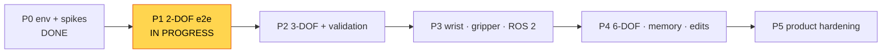

# CURRENT STATE — read this first

```yaml
updated: 2026-10-09
plan_version: v0.4 (IMPLEMENTATION_PLAN.md)
current_phase: P1
current_phase_status: in_progress; T1.1-T1.8, T1.10, T1.12 done — first milestone met (P0 closed; O11 deferred to P5)
next_action: T1.9 agents (requirements, resolver + checkpoint, design, part; rule router; budgets) on top of harness/pipeline.py stages; fix O13 first (S11 prompt → SDK program). Then T1.11 bench runner + B1-6/B1-7. Measure unverified card values when hardware is at hand (O12)
code_written: harness/ (worker protocol + tests), spikes/run.py, spikes/s01-s10, spikes/drivers/s10.py, components/ (card.py with card expressions, build.py, cards: servo/mg996r (+ horn), electronics/generic_bay, esp32_devkit, pca9685, fastener/m3_screw, m3_insert; servo_mg996r generator), tests/test_components.py, llm/ (tools, backend, agent_sdk_backend, claude_api_backend), spikes/s11_llm.py, spikes/urdf_1joint/, tests/test_llm_permissions.py, schemas/ (plan, signal, profile, names, export → schemas/json/), profiles/ (generic_fdm, materials), tests/test_schemas.py, sdk/ (expr, sketch, part, errors), tests/test_sdk.py + tests/freecad/sdk_cases.py, docs/sdk.md, harness/ (lint L0, part_ops worker ops, tools compile_part/probe_part, feedback), tests/test_harness_tools.py, assembly/ (kinematics, writer, builder), tests/test_assembly.py + tests/freecad/assembly_reopen.py, assembly/owners.py, validate/ (poses, statics, masses, plan_check, sweep worker ops, assembly_check, printability), tests/test_validate.py, export/urdf.py, description/checks.py, tests/test_export.py, packs/ (loader; manipulator: composites.py servo_u_bracket, knowledge.md, bench.yaml B1-1..5), tests/test_packs.py, harness/pipeline.py (run_job: plan → parts → L5/L6 → L7 → build → export → D1/D2/D4), bench/golden/b1_3/ (plan.json + parts base/turret/arm), tests/test_golden.py + tests/freecad/golden_edit.py (132 tests total)
git: branch p0-env-spikes, commits 2ce73d4, 7ee20dd (P0 closure), 82da443 (T1.1-T1.3), 1800634 (D28 revised), 175e1e7 (T1.4), 978bae1 (T1.5), 7b1e938 (T1.6), 50cbd61 (T1.7), af2070c (T1.8), 8def75c (T1.10), T1.12 commit; not pushed
```

## 1. How to use this directory (token-saving protocol)
1. Load **this file** + the **current phase file** only.
2. Open `IMPLEMENTATION_PLAN.md` only at the `§` cited in the phase file's `plan_refs`, and only when the phase file isn't enough.
3. Open `REFERECES/` files only via `REFERECES/REFERENCE_GUIDE.md`.
4. After any work session: update §2, §4, §5, §6 of this file (keep it < 150 lines). Phase files change only if scope or specs change; log that in §5.

## 2. Phase status



| Phase | File | Status | Exit met |
|---|---|---|---|
| P0 | `phase_0_environment_and_spikes.md` | done | yes (O11 open) |
| P1 | `phase_1_2dof_end_to_end.md` | in_progress | — |
| P2 | `phase_2_3dof_validation_depth.md` | not_started | — |
| P3 | `phase_3_wrist_gripper_ros2.md` | not_started | — |
| P4 | `phase_4_6dof_memory_edits.md` | not_started | — |
| P5 | `phase_5_product_hardening.md` | not_started | — |

## 3. Environment facts (verified 2026-10-09)

| Item | Value | Status |
|---|---|---|
| OS | Windows 11 Home 10.0.26200 | ok |
| FreeCAD | **1.1.4** (build 20260928), `C:/Program Files/FreeCAD 1.1/bin/freecadcmd.exe` | ok, `freecadcmd -c` runs |
| FreeCAD Python | 3.11.14 (bundled) | ok |
| System Python | 3.14 at `C:/Python314` | **don't use** for orchestrator |
| uv | 0.12.24 | ok → orchestrator venv (Python 3.12) |
| WSL | `Ubuntu`, `Ubuntu-22.04` | present; intended for ROS 2 tools / pinocchio fallback |
| Docker | 29.4.0, Docker Desktop running 2026-10-09; image `agenticcad-ros:jazzy` present | ok |
| conda | not installed | not needed unless pinocchio lacks a Windows wheel |
| Assembly / pivy import headless | `JointObject`, `UtilsAssembly`, `pivy` import; joints solve | ok (S1) |
| Orchestrator venv | uv-managed CPython 3.12.15, `python-preference = only-managed` (LibreOffice 3.12 on PATH breaks venvs) | ok |
| WSL | default distro `docker-desktop` (no bash) ⇒ always `wsl -d <distro>`; Ubuntu-22.04 has ROS 2 Humble (`check_urdf`), no gz / pinocchio; Ubuntu 26.04 bare; sudo needs a password | Humble fallback only |
| LLM auth | Claude Code subscription login present; no `ANTHROPIC_API_KEY` (not needed before P5) | Agent SDK ok; API backend offline (O11, P5) |
| pinocchio | no Windows wheel (`cmeel-assimp`) | → Docker image (D24) |

## 4. Task board (current phase: P1)

| ID | Task | Status |
|---|---|---|
| T1.1 | `schemas/` + JSON schema export | done: `Spec`, `AssemblyPlan` (+ `Param` ranges, `Connector`, `Joint`, `Mimic`, `Derived`), `Signal`, `TraceEvent`, `PrintProfile`; `python -m schemas.export`; test fails if JSON is stale |
| T1.2 | SDK core v0 + unit tests per call | done: `sdk/` (Part, params, datum, sketch rect/circle(s)/slot/polygon, pad, pocket, hole(fit), connector, mount, cable_channel, report, save); 16 cases in one worker run (~2 s); frame orientation param-bound (D28 revised); `mate_to` + `electronics_bay` moved to T1.4 |
| T1.3 | `profiles/generic_fdm.yaml`, `materials.yaml` | done: `profiles/__init__.py` (`load_profile`, `hole_diameter`) |
| T1.4 | Cards: ESP32 DevKit, PCA9685, M3 screw/insert (MG996R, generic bay exist) + MG996R horn interface; SDK `mate_to`, `electronics_bay` | done: 4 new cards + MG996R `horn` connector/interface; SDK `mate_to` (disc horn), `electronics_bay` (floor/walls/openings + standoffs), `mount` standoffs, `hole(fit="insert_m3", counterbore=)`; 22 SDK cases, all volumes exact |
| T1.5 | Harness tools `compile_part`, `probe_part`, signal formatter | done: `harness/lint.py` (L0), worker ops `compile_part`/`probe_part` (`harness/part_ops.py`), `harness/tools.py` (+ plan-side L3: connector pose 0.01 mm, label, bbox ±20 %), `harness/feedback.py`; `PartWorkspace` exposes both tools |
| T1.6 | Assembly builder | done: `assembly/kinematics.py` (pure-Python tree + FK, both Pythons), worker op `build_assembly` (`assembly/writer.py`), `assembly/builder.py` (card models rebuilt when stale); App::Link per owner, WB joints, preplace + residual gate per pose; reopen + param edit tested |
| T1.7 | Validators L0–L3, L5, L6 (+plan), L7-basic | done: `validate/plan_check.py` (cards, tree, DOF, drivers, tool, reach, L6-plan rods 0.5 g/mm), worker ops `sweep_assembly` (interference + owner mass props) / `mesh_parts` (`validate/sweep.py`), `validate/assembly_check.py` (L5 overlap + reach, L6 printed masses), `validate/printability.py` (L7-basic); L0–L3 stay in harness/ |
| T1.8 | Exporter + D1, D2, D4 | done: `export/urdf.py` (links = rigid groups, link frame = joint connector frame, printed-mass inertials, box/mesh collisions, tool0, ament package + `print/*.stl` mm), `description/checks.py` (D1 check_urdf + yourdfpy, D2 Pinocchio inertia/CRBA + gravity = −statics (7e-15 N·m), D4 `gz sdf -p`) in Docker |
| T1.9 | Agents + rule router + budgets | todo |
| T1.10 | Manipulator pack v0 | done: `packs/` loader (discovery, `meta`/`knowledge`/`bench`), `servo_u_bracket` (horn plate + idler plate under the case + bridge; default length clears the flange over ±90°), `knowledge.md` (requirement + connector notes), `bench.yaml` B1-1..5 with target Specs; reach check stays core (inert without `reach_mm`) |
| T1.11 | Bench runner + B1-6, B1-7 | todo |
| T1.12 | Golden B1-3 (no LLM) — first milestone | done: `bench/golden/b1_3` passes plan, L0–L3 ×3, L5 (26 poses, 0 overlaps, reach 155 mm), L6 (shoulder 0.10/0.54 N·m), L7, build, export, D1/D2/D4 in ~15 s via `harness/pipeline.run_job`; GUI-style edit (arm_len, turret sh_h) re-solves and moves tool0 exactly. Shoulder limits [−90°, +17°] keep the arm off the base. L7 caught a real defect on the way (yaw horn M2 tap 0.1 mm from the servo wall) |

P0 leftovers: none blocking (O11 deferred to P5).

## 5. Decision log (do not re-litigate)

| # | Decision | Source |
|---|---|---|
| D1 | Kernel: FreeCAD 1.x (pinned 1.1.4) + OCCT; CadQuery/build123d not primary; OpenSCAD/SolveSpace rejected (GPL) | plan §2.1 |
| D2 | Agents write programs against our FreeCAD-native SDK (Articraft pattern); ArtiCAD connector contract + deterministic assembly | plan §3.1–3.3 |
| D3 | Core + domain packs; manipulator arm is the benchmark, not the scope | plan §1.4, user 2026-10-09 |
| D4 | LLM: Claude. Prototype via Agent SDK on user's subscription; product via Claude API + API key behind `LLMBackend` | plan §2.3 |
| D5 | Models: Opus 5.5 for requirements/design/review; Sonnet 5.5 for part agents (escalate to Opus) and router | plan §2.3 |
| D6 | Actuators: MG996R main, MG90S wrist, SG90 gripper; derating 0.5 | plan §3.6, §6.2 |
| D7 | Electronics: generic 75×60×25 mm bay unless user names boards | plan §3.6 |
| D8 | Printing: printer-agnostic generic FDM profile; PETG default, PLA allowed | plan §4.2, §6.2 Q13 |
| D9 | 6-DOF target: 250 mm reach, 50 g payload (stretch 100 g); end effector SG90 parallel gripper | plan §6.2 Q11–Q12 |
| D10 | No closed loops; no GUI round-trip; no simulation in loop (Gazebo/ROS 2 compatible output only) | user answers Q2–Q4 |
| D11 | URDF exporter is our own; CROSS/RobotCAD (LGPL-2.1) as reference only | plan §5.2 |
| D12 | Two Pythons: SDK/worker inside freecadcmd (3.11); orchestrator in uv venv (3.12); JSON over files between them | P0 §1 |
| D13 | Mating rule: connector frames coincide at q=0; `T_child(q)=T_parent·Cp·Rz(q)·Cc⁻¹` | P0 §4 |
| D14 | Keep Assembly WB joints (S1 PASS). Joint refs = `[part, ["LCS.", "LCS."]]` (trailing dot) | S1, S2 |
| D15 | Posing = "preplace": own FK writes part placements + `Offset1=Rz(q)`, then `solve()` + LCS-coincidence residual gate. Offset-only flips 180° in chains | S3, S4 |
| D16 | Params binding: `sk.setExpression(".Constraints.<name>", "Params.<alias>")` | S5 |
| D17 | L2 sketch gate: pass iff `solve()==0 and FullyConstrained`; conflict/redundant list indices are **1-based** | S6 |
| D18 | Params cells written as `"=<value> <unit>"`; SDK validates aliases (unit symbols like `h`, `m`, `s`, `g`, `deg` are rejected) | S7 |
| D19 | "Sketch on a face" = sketch on a `PartDesign::Plane` whose offset is bound to Params (no face refs, no TNP) | S7, S8 |
| D20 | Geometry gate checks `len(Solids)==1`, volume > 0 and object `State`; `recompute()` return value is not a status | S10 |
| D21 | Mass props: feature `.Shape` excludes parent `App::Part` placement; inertia about CoM, density 1, mm⁵ | S9 |
| D22 | Card frame = its mount connector (MG996R: flange underside, centred on holes, +z to shaft). Card `connectors`/`interfaces` name `params_mm` entries (`components/card.py: resolve`); generators bind sketches + LCS to the same Params | T0.6 |
| D23 | LLM action space: tools defined once as `ToolSpec`; path policy in `PartWorkspace`; Agent SDK hardened with `tools=[]`, MCP server tools only, `dontAsk`, PreToolUse deny hook, `setting_sources=[]`, `strict_mcp_config`, `skills=[]` | S11 |
| D25 | Two Signal types: worker wire `harness.protocol.Signal` (frozen v1, `info`, no evidence) and orchestrator `schemas.signal.Signal` (`note`, `evidence`); convert with `Signal.from_worker` | T1.1 |
| D26 | Names (params, parts, connectors, joints) = lower_snake_case, not a FreeCAD unit symbol (`schemas/names.py`, shared with the SDK). Schemas check structure only; cross-refs/tree/DOF are the plan validator's (signals, not exceptions) | T1.1 |
| D27 | SDK: every length is a `Q` (value + FreeCAD expression); literals auto-promoted to Params aliases (`source: literal`), card dims to `<component>_<param>`, profile fits to `fit_*` / `tap_m3`, so every dimension is GUI-editable (no `fixed:` tag). Literals in sums carry the unit (`+ 3 mm`; unitless fails). Sheet columns name/value/min/max/source. `agenticcad` = alias of `sdk` | T1.2 |
| D28 | Frames (connector LCS, datum frames, mount frames, channels) = one whole-Placement expression `placement(vector(x; y; z); rotationz(yaw) * rotationy(pitch) * rotationx(roll))` (LCS `.Placement`, datum `.AttachmentOffset` on body XY); origin **and** orientation bound to Params (`<name>_yaw/_pitch/_roll`, deg; `rot=` arg alternative to z/x). Channels: yaw/pitch = atan2/acos of end − start. Keep-outs attach to the mount frame datum with a local z offset. Per-component `.Rotation.Yaw` bindings rejected (gimbal-lock fights at pitch 90°). User confirmed D27/D28 2026-10-09: editability first | T1.2 |
| D29 | Card values may be param expressions (`"spline_top + horn_top_above_tip - horn_disc_t"`, + - * / only, `components/card.py`); SDK and generators bind them as FreeCAD expressions. Card frame = the host surface the component rests on, +z out of it (servo flange underside, bay floor top, board recess top). Electronics cards share `volume` / `standoffs` / `openings` / `keep_out` interfaces | T1.4 |
| D30 | `mate_to("<comp>.horn", at)`: card `horn` connector = horn disc underside (same axis as `output_shaft`); driven part's face at z = 0, recess + M2 taps + screwdriver access cut above it. `electronics_bay` floor_t default = `max(3 mm, deepest card cut below the frame + min_wall)` (live FreeCAD `max()`); slotted standoffs = slot + M3 nut trap from the floor underside | T1.4 |
| D31 | L0 is a guardrail, not a sandbox: SDK-only surface (no `_attrs`, no raw `.doc/.body/.sheet/.obj`), worker process = boundary. compile_part = L0 → worker (L1, L2, local L3, save .FCStd) → plan-side L3 on the orchestrator; feedback = status line + ≤ 8 signals, failures first. probe_part reopens the .FCStd read-only; snippet's last expression is the result. Stale .FCStd deleted before each compile | T1.5 |
| D32 | Assembly = `assembly.FCStd` saved first, then one `App::Link` per part/card model .FCStd (relative external links; reopening loads them; a part param edit + `solve()` propagates). Cards without a generator → envelope App::Part (LCS per connector + `interfaces.volume` box) inside the assembly. Component attach = WB Fixed joint `attach_<id>` (card mount connector = the LCS at the card frame origin). Plan→WB types: revolute/continuous/gears → Revolute, slider/rack_pinion → Slider (`Offset1 = Tz(d)` drives it), cylindrical, ball, fixed. Residual gate 1e-4 mm / 1e-4°, gate L5. The WB does not store q: a free slider absorbs a length edit along its axis; poses come from our FK only | T1.6 |
| D33 | L6 static torque = pure-Python gravity term (`validate/statics.py`: moment of downstream weights about each joint axis), exactly RNEA(q, 0, 0) without Pinocchio on Windows; Pinocchio stays in D2 and cross-checks it. Allowed = stall@6V × card derating × servos_on_axis; > 85 % warning. Reach = max horizontal distance tool → root moving joint origin over a dense grid (19/joint, ≤ 4000 poses) | T1.7 |
| D34 | L5 interference: owners placed by our FK (no WB solve), OCCT `common` > 1 mm³ fails; rest + grid 9/joint decimated to ≤ 25 poses; pairs in one rigid group (attach / fixed) checked at rest only; `AssemblyPlan.allow_overlap` [(a, b)] exempts pairs. L7-basic: build volume by sorted extents, watertight via trimesh, min wall by inward ray cast per facet, fail if thin area > 1 mm² | T1.7 |
| D36 | Exporter: fixed plan joints merge into rigid-group links (no URDF fixed joints except tool0); link named after its group root owner; URDF numbers written %.12g; cylindrical/ball not exported in P1 | T1.8 |
| D35 | MG996R travel stays ±90° on the card (user 2026-10-09), although the datasheet says ~120°; verify on a sample (O12) | user |
| D37 | Packs are discovered, never named by the core: `sdk/__init__` calls `packs.load_composites()` (imports every `packs/<id>/composites.py`, which registers methods on `Part`); pack `__init__.py` = metadata only (no FreeCAD), so the orchestrator reads knowledge/bench as data. Reach check stays in core gates | T1.10 |
| D38 | `harness/pipeline.run_job(job_dir)` = the one ordered stage list (plan → parts → assembly L5/L6 → print L7 → build → export → description), stops at the first failing stage, writes `out/report.json`; agents and the bench reuse it. Golden jobs live in `bench/golden/<id>/` | T1.12 |
| D24 | Linux-side checks (check_urdf, `gz sdf -p`, pinocchio; later ROS 2 / Gazebo gates) run in Docker image `agenticcad-ros:jazzy` built from `docker/ros-tools/Dockerfile`; package dir mounted read-only. WSL Humble is a fallback (`AGENTICCAD_LINUX=wsl`) | T0.7 |

## 6. Open items / blockers

| # | Item | Resolved by |
|---|---|---|
| O11 | Live ClaudeAPIBackend run. **Deferred to P5** (user 2026-10-09): prototype and bench run on the Agent SDK + subscription (D4); the API backend stays offline-tested until productization | P5 |
| O9 | Assembly WB `Gears`/`RackPinion` headless | P3 S12 |
| O13 | `spikes/s11_llm.py` prompts a raw FreeCAD script; compile_part now requires SDK programs (L0). Update the prompt and re-run S11 live on the Agent SDK backend | T1.9 |
| O12 | Datasheet pass 2026-10-09: ESP32 DevKitC (Espressif drawing) and PCA9685 (Adafruit fab print) now `verified: true`; M3 insert hole matches vendor charts. Still unverified: MG996R hole pitch, flange height, shaft offset, horn disc (no vendor drawing exists); travel kept ±90° (D35). Measure a sample when available | user (hardware) |

## 7. File map

| Path | What |
|---|---|
| `implementation_context/IMPLEMENTATION_PLAN.md` | full plan v0.4 (moved here from repo root) |
| `implementation_context/phase_*.md` | per-phase specs, tasks, exit criteria, prev/next notes |
| `AGENTS.md` | project goal + working rules |
| `REFERECES/REFERENCE_GUIDE.md` | index of papers and research notes |
| `REFERECES/freecad_headless_scripting_research_report.md` | FreeCAD API notes (corrected; tags resolved against 1.1.4 in P0) |
| `docs/env.md`, `docs/spike_results.md`, `docs/worker_protocol.md` | env facts; spike answers; frozen worker protocol v1 (P1 reads these) |
| `harness/` | worker protocol: `run.py` (orchestrator), `worker.py` (freecadcmd), `protocol.py` |
| `spikes/` | `run.py` runner, `sNN_*.py`, `drivers/` (orchestrator-side), `results/` (generated) |
| `components/` | cards (`<family>/<id>.yaml`), `card.py` (load/resolve), `build.py` (CLI), `generators/` |
| `build/` | generated models (`build/components/*.FCStd`), not source |
| `schemas/` | pydantic contracts; `names.py` is FreeCAD-safe; `json/` generated |
| `profiles/` | print profiles + materials (pure-Python loader) |
| `sdk/` | FreeCAD-native SDK v0 (runs in freecadcmd); `docs/sdk.md` = agent-facing reference |
| `assembly/` | `kinematics.py` (tree + FK, pure Python), `owners.py` (worker: load parts/cards/envelopes), `writer.py` (worker op `build_assembly`), `builder.py` (orchestrator) |
| `export/`, `description/` | URDF package writer; D1/D2/D4 checks (Docker) |
| `validate/` | `plan_check.py`, `assembly_check.py`, `printability.py` (orchestrator); `sweep.py` (worker ops); `poses.py`, `statics.py`, `masses.py` (pure Python) |
| `llm/` | `LLMBackend` + `AgentSDKBackend` / `ClaudeAPIBackend`; `tools.py` (`ToolSpec`, `PartWorkspace`) |
| `Articad Architecture diagram.png` | ArtiCAD Fig. 2 (mapped in plan §1.5) |
