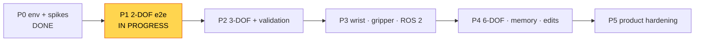

# CURRENT STATE — read this first

```yaml
updated: 2026-10-09
plan_version: v0.4 (IMPLEMENTATION_PLAN.md)
current_phase: P1
current_phase_status: in_progress; T1.1, T1.2, T1.3 done (P0 closed except O11 live API run)
next_action: T1.4 cards (ESP32 DevKit, PCA9685, M3 screw/insert) + MG996R horn data -> SDK mate_to + electronics_bay; then T1.5 compile_part/probe_part
code_written: harness/ (worker protocol + tests), spikes/run.py, spikes/s01-s10, spikes/drivers/s10.py, components/ (card.py, build.py, mg996r + generic_bay cards, servo_mg996r generator), tests/test_components.py, llm/ (tools, backend, agent_sdk_backend, claude_api_backend), spikes/s11_llm.py, spikes/urdf_1joint/, tests/test_llm_permissions.py, schemas/ (plan, signal, profile, names, export → schemas/json/), profiles/ (generic_fdm, materials), tests/test_schemas.py, sdk/ (expr, sketch, part, errors), tests/test_sdk.py + tests/freecad/sdk_cases.py, docs/sdk.md (55 tests total)
git: branch p0-env-spikes, commits 2ce73d4, 7ee20dd (P0 closure), 82da443 (T1.1-T1.3), not pushed; D28 revision (param-bound frame orientation) uncommitted
```

## 1. How to use this directory (token-saving protocol)
1. Load **this file** + the **current phase file** only.
2. Open `IMPLEMENTATION_PLAN.md` only at the `§` cited in the phase file's `plan_refs`, and only when the phase file isn't enough.
3. Open `REFERECES/` files only via `REFERECES/REFERENCE_GUIDE.md`.
4. After any work session: update §2, §4, §5, §6 of this file (keep it < 150 lines). Phase files change only if scope or specs change; log that in §5.

## 2. Phase status



| Phase | File | Status | Exit met |
|---|---|---|---|
| P0 | `phase_0_environment_and_spikes.md` | done | yes (O11 open) |
| P1 | `phase_1_2dof_end_to_end.md` | in_progress | — |
| P2 | `phase_2_3dof_validation_depth.md` | not_started | — |
| P3 | `phase_3_wrist_gripper_ros2.md` | not_started | — |
| P4 | `phase_4_6dof_memory_edits.md` | not_started | — |
| P5 | `phase_5_product_hardening.md` | not_started | — |

## 3. Environment facts (verified 2026-10-09)

| Item | Value | Status |
|---|---|---|
| OS | Windows 11 Home 10.0.26200 | ok |
| FreeCAD | **1.1.4** (build 20260928), `C:/Program Files/FreeCAD 1.1/bin/freecadcmd.exe` | ok, `freecadcmd -c` runs |
| FreeCAD Python | 3.11.14 (bundled) | ok |
| System Python | 3.14 at `C:/Python314` | **don't use** for orchestrator |
| uv | 0.12.24 | ok → orchestrator venv (Python 3.12) |
| WSL | `Ubuntu`, `Ubuntu-22.04` | present; intended for ROS 2 tools / pinocchio fallback |
| Docker | 29.4.0 installed, **daemon not running** | start Docker Desktop when needed |
| conda | not installed | not needed unless pinocchio lacks a Windows wheel |
| Assembly / pivy import headless | `JointObject`, `UtilsAssembly`, `pivy` import; joints solve | ok (S1) |
| Orchestrator venv | uv-managed CPython 3.12.15, `python-preference = only-managed` (LibreOffice 3.12 on PATH breaks venvs) | ok |
| WSL | default distro `docker-desktop` (no bash) ⇒ always `wsl -d <distro>`; Ubuntu-22.04 has ROS 2 Humble (`check_urdf`), no gz / pinocchio; Ubuntu 26.04 bare; sudo needs a password | Humble fallback only |
| LLM auth | Claude Code subscription login present; no `ANTHROPIC_API_KEY` | Agent SDK ok; API backend offline (O11) |
| pinocchio | no Windows wheel (`cmeel-assimp`) | → Docker image (D24) |

## 4. Task board (current phase: P1)

| ID | Task | Status |
|---|---|---|
| T1.1 | `schemas/` + JSON schema export | done: `Spec`, `AssemblyPlan` (+ `Param` ranges, `Connector`, `Joint`, `Mimic`, `Derived`), `Signal`, `TraceEvent`, `PrintProfile`; `python -m schemas.export`; test fails if JSON is stale |
| T1.2 | SDK core v0 + unit tests per call | done: `sdk/` (Part, params, datum, sketch rect/circle(s)/slot/polygon, pad, pocket, hole(fit), connector, mount, cable_channel, report, save); 16 cases in one worker run (~2 s); frame orientation param-bound (D28 revised); `mate_to` + `electronics_bay` moved to T1.4 |
| T1.3 | `profiles/generic_fdm.yaml`, `materials.yaml` | done: `profiles/__init__.py` (`load_profile`, `hole_diameter`) |
| T1.4 | Cards: ESP32 DevKit, PCA9685, M3 screw/insert (MG996R, generic bay exist) + MG996R horn interface; SDK `mate_to`, `electronics_bay` | todo (next) |
| T1.5 | Harness tools `compile_part`, `probe_part`, signal formatter | todo |
| T1.6 | Assembly builder | todo |
| T1.7 | Validators L0–L3, L5, L6 (+plan), L7-basic | todo |
| T1.8 | Exporter + D1, D2, D4 | todo |
| T1.9 | Agents + rule router + budgets | todo |
| T1.10 | Manipulator pack v0 | todo |
| T1.11 | Bench runner + B1-6, B1-7 | todo |
| T1.12 | Golden B1-3 (no LLM) — first milestone | todo |

P0 leftovers: O11 (live ClaudeAPIBackend run).

## 5. Decision log (do not re-litigate)

| # | Decision | Source |
|---|---|---|
| D1 | Kernel: FreeCAD 1.x (pinned 1.1.4) + OCCT; CadQuery/build123d not primary; OpenSCAD/SolveSpace rejected (GPL) | plan §2.1 |
| D2 | Agents write programs against our FreeCAD-native SDK (Articraft pattern); ArtiCAD connector contract + deterministic assembly | plan §3.1–3.3 |
| D3 | Core + domain packs; manipulator arm is the benchmark, not the scope | plan §1.4, user 2026-10-09 |
| D4 | LLM: Claude. Prototype via Agent SDK on user's subscription; product via Claude API + API key behind `LLMBackend` | plan §2.3 |
| D5 | Models: Opus 5.5 for requirements/design/review; Sonnet 5.5 for part agents (escalate to Opus) and router | plan §2.3 |
| D6 | Actuators: MG996R main, MG90S wrist, SG90 gripper; derating 0.5 | plan §3.6, §6.2 |
| D7 | Electronics: generic 75×60×25 mm bay unless user names boards | plan §3.6 |
| D8 | Printing: printer-agnostic generic FDM profile; PETG default, PLA allowed | plan §4.2, §6.2 Q13 |
| D9 | 6-DOF target: 250 mm reach, 50 g payload (stretch 100 g); end effector SG90 parallel gripper | plan §6.2 Q11–Q12 |
| D10 | No closed loops; no GUI round-trip; no simulation in loop (Gazebo/ROS 2 compatible output only) | user answers Q2–Q4 |
| D11 | URDF exporter is our own; CROSS/RobotCAD (LGPL-2.1) as reference only | plan §5.2 |
| D12 | Two Pythons: SDK/worker inside freecadcmd (3.11); orchestrator in uv venv (3.12); JSON over files between them | P0 §1 |
| D13 | Mating rule: connector frames coincide at q=0; `T_child(q)=T_parent·Cp·Rz(q)·Cc⁻¹` | P0 §4 |
| D14 | Keep Assembly WB joints (S1 PASS). Joint refs = `[part, ["LCS.", "LCS."]]` (trailing dot) | S1, S2 |
| D15 | Posing = "preplace": own FK writes part placements + `Offset1=Rz(q)`, then `solve()` + LCS-coincidence residual gate. Offset-only flips 180° in chains | S3, S4 |
| D16 | Params binding: `sk.setExpression(".Constraints.<name>", "Params.<alias>")` | S5 |
| D17 | L2 sketch gate: pass iff `solve()==0 and FullyConstrained`; conflict/redundant list indices are **1-based** | S6 |
| D18 | Params cells written as `"=<value> <unit>"`; SDK validates aliases (unit symbols like `h`, `m`, `s`, `g`, `deg` are rejected) | S7 |
| D19 | "Sketch on a face" = sketch on a `PartDesign::Plane` whose offset is bound to Params (no face refs, no TNP) | S7, S8 |
| D20 | Geometry gate checks `len(Solids)==1`, volume > 0 and object `State`; `recompute()` return value is not a status | S10 |
| D21 | Mass props: feature `.Shape` excludes parent `App::Part` placement; inertia about CoM, density 1, mm⁵ | S9 |
| D22 | Card frame = its mount connector (MG996R: flange underside, centred on holes, +z to shaft). Card `connectors`/`interfaces` name `params_mm` entries (`components/card.py: resolve`); generators bind sketches + LCS to the same Params | T0.6 |
| D23 | LLM action space: tools defined once as `ToolSpec`; path policy in `PartWorkspace`; Agent SDK hardened with `tools=[]`, MCP server tools only, `dontAsk`, PreToolUse deny hook, `setting_sources=[]`, `strict_mcp_config`, `skills=[]` | S11 |
| D25 | Two Signal types: worker wire `harness.protocol.Signal` (frozen v1, `info`, no evidence) and orchestrator `schemas.signal.Signal` (`note`, `evidence`); convert with `Signal.from_worker` | T1.1 |
| D26 | Names (params, parts, connectors, joints) = lower_snake_case, not a FreeCAD unit symbol (`schemas/names.py`, shared with the SDK). Schemas check structure only; cross-refs/tree/DOF are the plan validator's (signals, not exceptions) | T1.1 |
| D27 | SDK: every length is a `Q` (value + FreeCAD expression); literals auto-promoted to Params aliases (`source: literal`), card dims to `<component>_<param>`, profile fits to `fit_*` / `tap_m3`, so every dimension is GUI-editable (no `fixed:` tag). Literals in sums carry the unit (`+ 3 mm`; unitless fails). Sheet columns name/value/min/max/source. `agenticcad` = alias of `sdk` | T1.2 |
| D28 | Frames (connector LCS, datum frames, mount frames, channels) = one whole-Placement expression `placement(vector(x; y; z); rotationz(yaw) * rotationy(pitch) * rotationx(roll))` (LCS `.Placement`, datum `.AttachmentOffset` on body XY); origin **and** orientation bound to Params (`<name>_yaw/_pitch/_roll`, deg; `rot=` arg alternative to z/x). Channels: yaw/pitch = atan2/acos of end − start. Keep-outs attach to the mount frame datum with a local z offset. Per-component `.Rotation.Yaw` bindings rejected (gimbal-lock fights at pitch 90°). User confirmed D27/D28 2026-10-09: editability first | T1.2 |
| D24 | Linux-side checks (check_urdf, `gz sdf -p`, pinocchio; later ROS 2 / Gazebo gates) run in Docker image `agenticcad-ros:jazzy` built from `docker/ros-tools/Dockerfile`; package dir mounted read-only. WSL Humble is a fallback (`AGENTICCAD_LINUX=wsl`) | T0.7 |

## 6. Open items / blockers

| # | Item | Resolved by |
|---|---|---|
| O11 | `ANTHROPIC_API_KEY` for the live ClaudeAPIBackend run (offline tests pass) | user |
| O9 | Assembly WB `Gears`/`RackPinion` headless | P3 S12 |

## 7. File map

| Path | What |
|---|---|
| `implementation_context/IMPLEMENTATION_PLAN.md` | full plan v0.4 (moved here from repo root) |
| `implementation_context/phase_*.md` | per-phase specs, tasks, exit criteria, prev/next notes |
| `AGENTS.md` | project goal + working rules |
| `REFERECES/REFERENCE_GUIDE.md` | index of papers and research notes |
| `REFERECES/freecad_headless_scripting_research_report.md` | FreeCAD API notes (corrected; tags resolved against 1.1.4 in P0) |
| `docs/env.md`, `docs/spike_results.md`, `docs/worker_protocol.md` | env facts; spike answers; frozen worker protocol v1 (P1 reads these) |
| `harness/` | worker protocol: `run.py` (orchestrator), `worker.py` (freecadcmd), `protocol.py` |
| `spikes/` | `run.py` runner, `sNN_*.py`, `drivers/` (orchestrator-side), `results/` (generated) |
| `components/` | cards (`<family>/<id>.yaml`), `card.py` (load/resolve), `build.py` (CLI), `generators/` |
| `build/` | generated models (`build/components/*.FCStd`), not source |
| `schemas/` | pydantic contracts; `names.py` is FreeCAD-safe; `json/` generated |
| `profiles/` | print profiles + materials (pure-Python loader) |
| `sdk/` | FreeCAD-native SDK v0 (runs in freecadcmd); `docs/sdk.md` = agent-facing reference |
| `llm/` | `LLMBackend` + `AgentSDKBackend` / `ClaudeAPIBackend`; `tools.py` (`ToolSpec`, `PartWorkspace`) |
| `Articad Architecture diagram.png` | ArtiCAD Fig. 2 (mapped in plan §1.5) |
