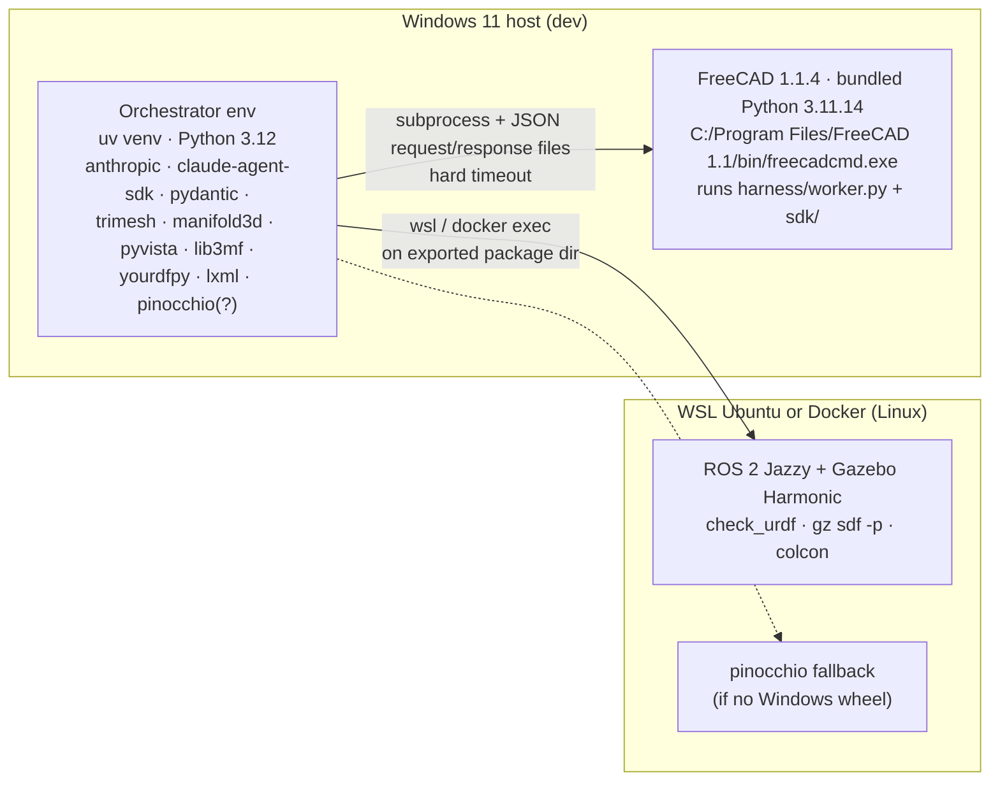

# PHASE 0 — Environment and API spikes (no LLM agents yet)

```yaml
id: P0
status: in_progress            # mirror of current_state.md
duration_estimate: 10 working days
depends_on: [plan v0.4]
blocks: [P1]
plan_refs: [§2.1, §2.2, §2.3, §6.1 risk 1-2, §6.4 P0]
goal: every FreeCAD / LLM / ROS API the SDK needs is confirmed by a running test, or has a chosen fallback
```

## 0. Previous phase (planning) — keep in mind
- Plan is v0.4 in `IMPLEMENTATION_PLAN.md`. Do not re-decide: FreeCAD kernel, connector contract, Articraft-style SDK, core + domain packs, `LLMBackend` interface.
- `REFERECES/freecad_headless_scripting_research_report.md` was corrected against FreeCAD source but NOT run. Items tagged `[UNVERIFIED]` there = spikes S1–S7 below.
- No code exists yet. Repo `master` has only untracked docs.

## 1. Environment topology



Rules:
- **Two Pythons, never mixed.** The SDK and worker import `FreeCAD` and run only inside `freecadcmd.exe` (Python 3.11). Everything else runs in the orchestrator env. Shared code (pydantic schemas) must be pure-Python and 3.11-compatible; the worker reads/writes plain JSON, so it does not need pydantic.
- The system Python 3.14 is not used (wheels for pinocchio / pyvista may lag).
- Pin FreeCAD **1.1.4**. Record `FreeCAD.Version()` in every job trace.

## 2. Tasks

| ID | Task | Output | Done when |
|---|---|---|---|
| T0.1 | Record FreeCAD install facts | `docs/env.md` | version, bin path, Python version, `import Part, Sketcher, PartDesign, Spreadsheet, pivy` result |
| T0.2 | Orchestrator env with uv (Python 3.12) | `pyproject.toml`, `uv.lock` | all §1 packages import; note any that need WSL |
| T0.3 | Worker protocol prototype | `harness/worker.py`, `harness/run.py` | orchestrator runs a request, gets JSON back, kills on timeout |
| T0.4 | Spikes S1–S11 (§3) | `spikes/sNN_*.py` + `docs/spike_results.md` | each spike: PASS / FAIL + chosen fallback |
| T0.5 | Correct the R1/R2 report | edit `REFERECES/freecad_headless_scripting_research_report.md` | every `[UNVERIFIED]` becomes `[VERIFIED 1.1.4]` or `[FALSE → fallback]` |
| T0.6 | MG996R card + generator; generic electronics bay card | `components/servo/mg996r.yaml`, `components/generators/servo_mg996r.py`, `components/electronics/generic_bay.yaml` | generator builds a fully constrained `.FCStd` with `body_mount` and `output_shaft` LCS |
| T0.7 | Hand-written 1-joint URDF package | `spikes/urdf_1joint/` | passes `check_urdf`, `gz sdf -p`, yourdfpy load, pinocchio load |
| T0.8 | LLM backend spike | `llm/backend.py`, `llm/agent_sdk_backend.py`, `llm/claude_api_backend.py`, `spikes/s11_llm.py` | one tool `compile_part` callable from both backends; write restriction proven by a test |
| T0.9 | Git hygiene | `.gitignore` (jobs/, build/, *.FCBak, .venv), first commit on a branch | user approves the commit |

## 3. Spikes (each = one script, one assertion set)

| ID | Question | Test | Pass criterion | Fallback if FAIL |
|---|---|---|---|---|
| S1 | Does `import UtilsAssembly, JointObject` work in `freecadcmd` (GuiUp = False)? | import + create `Assembly::AssemblyObject`, `Assembly::JointGroup`, a GroundedJoint and a Revolute between two boxes, `recompute()` | no exception; `assembly.solve()` returns 0 | (a) stub `pivy` module; (b) **own SE(3) aligner** writes placements + stores joint metadata as custom properties (no Assembly WB joints) |
| S2 | Can a joint reference an `App::LocalCoordinateSystem` inside an `App::Part`/Body? | build LCS in each part, `setJointConnectors(rev, [[partA, ["LCS_a.", "LCS_a."]], [partB, ["LCS_b.", ...]]])` (try sub-element spellings) | after solve, LCS_a and LCS_b world frames coincide (< 1e-6 mm) | reference the LCS origin vertex / a datum face; or own aligner |
| S3 | How to drive a revolute joint to angle q headless? | try `Offset2.Rotation` = Rz(q), then `assembly.solve()`; also check for a solver drive API | child rotates by q about the joint axis (FK error < 1e-6) | compute child placement ourselves `T_child(q)` (§4) and keep joints only for GUI editing |
| S4 | Are `Placement1/2` local (to referenced object) or global? | known offsets, compare with `obj.getGlobalPlacement()` | documented answer + helper `joint_frames_world(joint)` | — (documentation spike) |
| S5 | Expression path for sketch constraints | `sk.renameConstraint(i,"len")`; try `sk.setExpression("Constraints.len","Params.upper_arm_len")` and `".Constraints.len"`; spreadsheet `setAlias` | changing the cell + recompute changes geometry | set datum values from Python each compile (loses live params → **must not happen**; escalate) |
| S6 | Sketch diagnostics reality | 4 sketches: fully constrained, under (1 free point), conflicting, redundant | record `solve()` code, `DoF`, `FullyConstrained`, the 4 lists, `getGeometryWithDependentParameters()` | adjust L2 gate spec to observed behaviour |
| S7 | Datum attachment headless | `PartDesign::Plane` / LCS with `AttachmentSupport` + `MapMode`, offset bound to `Params`; change param | datum and the sketch on it move; no TNP error | attach to Body origin planes + offset placement expression |
| S8 | Full single-part pipeline | Body → datum → constrained sketch → Pad → Pocket → change `Params` → recompute → save `.FCStd` → STEP + STL | reopened file has same feature tree; volume changes as expected | — |
| S9 | Mass properties frame and units | `shape.Volume`, `CenterOfMass`, `MatrixOfInertia` on a known box with non-identity placement | documented: units (mm, mm³, mm⁵), frame (global vs. local), density not applied | — |
| S10 | Hang / crash behaviour | infinite-loop expression, degenerate pad | orchestrator kills worker at timeout, returns `failure` signal | — |
| S11 | Agent SDK + API backend | see T0.8 | both backends run `compile_part`; Agent SDK built-in tools disabled; `Write` outside `parts/<own>.py` rejected | Claude API backend only |

Also: confirm OndselSolver license file (LGPL-2.1 expected) → update plan §2.2.

## 4. Conventions fixed in P0 (used by every later phase)


- **Mating rule:** at q = 0 the two connector frames *coincide* (same origin, same z, same x). Designers orient `z`/`x` in the plan so this is true. ⇒ `T_child(q) = T_parent · Cp · Rz(q) · Cc⁻¹`.
- Joint axis = connector `z`. Revolute positive direction = right-hand about `z`.
- Units: CAD mm, kg (cards), URDF m/kg/rad. Conversion only in the exporter.
- URDF link frame of a child link = its joint connector frame ⇒ every joint `axis="0 0 1"`.

## 5. Worker protocol (draft; freeze at P0 exit)

```jsonc
// request (written by orchestrator to <job>/io/req_<n>.json)
{ "op": "compile_part", "part": "upper_arm", "program": "parts/upper_arm.py",
  "plan": "plan.json", "profile": "print_profile.json", "out": "build/upper_arm.FCStd",
  "timeout_s": 60 }
// response (<job>/io/res_<n>.json)
{ "ok": false, "signals": [ { "level": "failure", "gate": "L2", "cause": "...", "location": "...", "action": "..." } ],
  "artifacts": { "fcstd": "...", "step": "...", "stl": "..." }, "metrics": { "volume_mm3": 0, "dof": [] },
  "freecad_version": "1.1.4", "elapsed_s": 0.0 }
```
- Pass the request path via env var `AGENTICCAD_REQUEST` (freecadcmd treats extra CLI args as files to open — verify in T0.3).
- One worker process per request at first; a warm worker pool is a P2+ optimisation.

## 6. Risks specific to P0

| Risk | Signal | Response |
|---|---|---|
| S1 fails (pivy / GUI coupling) | ImportError, segfault | take fallback (b); Assembly WB becomes optional output only |
| No pinocchio wheel for Windows | pip/uv install fails | run L6/D2/D5 in WSL Ubuntu via a small CLI wrapper |
| Docker daemon not running | `docker info` fails | use WSL Ubuntu for ROS 2 tools instead |
| Agent SDK can't fully disable built-in tools | spike S11 | `ClaudeAPIBackend` becomes the default earlier |

## 7. Exit criteria (all required)
- [ ] S1–S10 have PASS or a fallback that is implemented as a stub function.
- [ ] S11: both backends call `compile_part`; permission test green.
- [ ] Worker protocol frozen (§5) and covered by one test.
- [ ] MG996R generator `.FCStd`: all sketches DoF = 0, connectors present.
- [ ] 1-joint URDF passes `check_urdf` + `gz sdf -p`.
- [ ] R1/R2 report has no `[UNVERIFIED]` tags left; `current_state.md` updated.

## 8. Next phase (P1) — prepare for
- P1 builds on: worker protocol, mating rule (§4), S2/S3 outcome (Assembly WB joints vs. own aligner), S5 expression syntax (the SDK's `Params` binding depends on it), S6 diagnostic semantics (L2 gate).
- Write `docs/spike_results.md` so P1 can read *only that* instead of re-running spikes.
- Keep the MG996R generator generic: P1's `mount()` and `mate_to()` read card `interfaces`, not MG996R literals.
