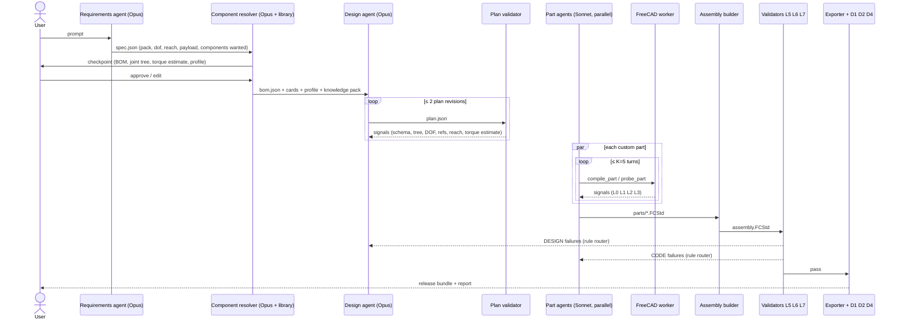
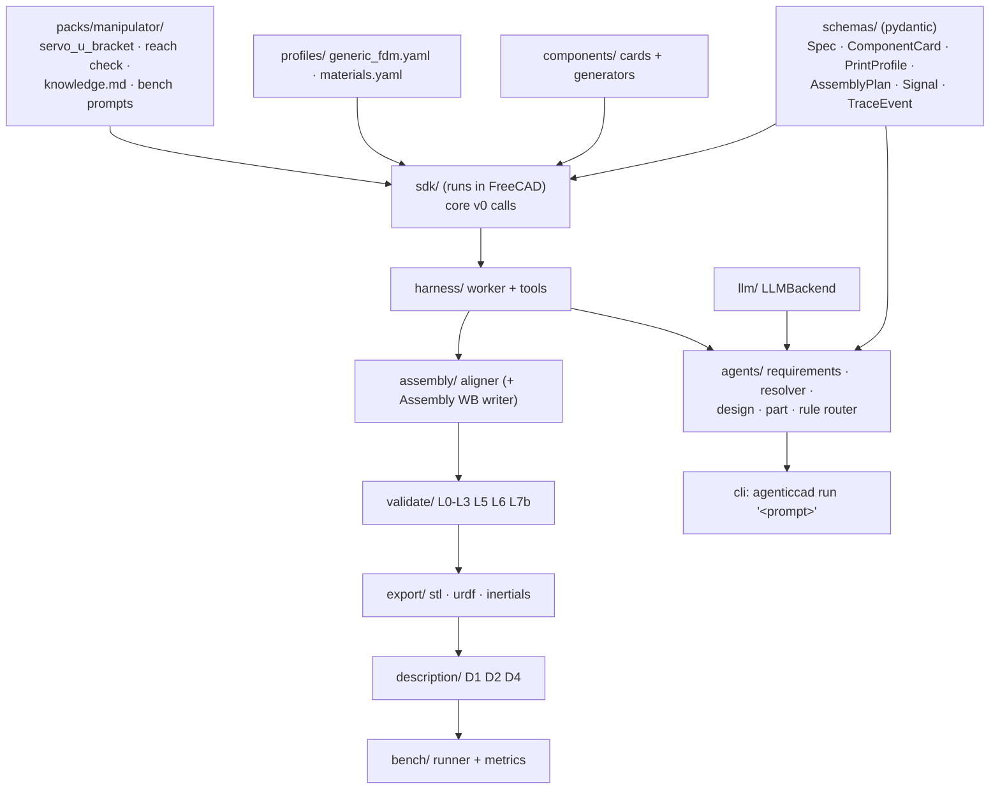

# PHASE 1 — 2-DOF manipulator end-to-end (smallest full pipeline)

```yaml
id: P1
status: not_started
duration_estimate: 21 working days
depends_on: [P0 exit]
blocks: [P2]
plan_refs: [§1.1-1.4, §3.2-3.4, §3.6, §4.1 L0-L3 L5 L6 L7(basic), §4.3, §5.1-5.4 D1 D2 D4, §6.4 P1]
goal: text prompt → confirmed BOM → plan → parametric .FCStd parts + assembly → STL + URDF, for 2-DOF arms AND 2 non-arm mechanisms
```

## 0. Previous phase (P0) — keep in mind
- Read `docs/spike_results.md` first. Branches that change P1 code:
  - S1/S2/S3 PASS → assembly builder writes Assembly WB joints. FAIL → own aligner; joints stored as metadata properties.
  - S5 syntax → used verbatim by `Params` binding. If S5 failed, P1 is blocked (parametric requirement).
  - S6 observed codes → L2 gate thresholds.
- Mating rule `T_child(q) = T_parent · Cp · Rz(q) · Cc⁻¹` (P0 §4) is the only alignment math.
- Worker protocol (P0 §5) is frozen; extend with new `op`s, don't change fields.

## 1. Scope

| In | Out (later phase) |
|---|---|
| 2 × MG996R (yaw + shoulder or shoulder + elbow), generic electronics bay or named board | wrist, gripper (P3) |
| Text input; console checkpoint | image input (P4); web UI (P5) |
| Gates L0, L1, L2, L3, L5, L6, L7-basic | L3v, L4, L7-full, L8 (P2) |
| URDF + meshes + inertials + primitive collisions + `tool0`; D1, D2, D4 | ROS 2 package with ros2_control, D3 full, D5 (P3) |
| Rule-based router (gate → CODE/DESIGN table) | LLM router, model escalation (P2) |
| Core + manipulator pack + *core-only* mechanisms | mechanisms pack composites (P2) |

## 2. Job sequence



## 3. Module map (build order = top to bottom)



## 4. Specs

### 4.1 Schemas (pydantic, orchestrator side; JSON on the worker side)
- `Spec`: `pack: str|None`, `dof: int`, `reach_mm: float|None`, `payload_g: float|None`, `components_requested: [str]`, `electronics: "generic"|[card_id]`, `print_profile: str`, `material: "PETG"|"PLA"`, `notes`.
- `AssemblyPlan`: as plan §3.2 + **params with ranges** `{name: {value, min, max, unit}}` (ranges needed by L4 in P2; required now).
- `Connector`: `name, o[3], z[3], x[3], label` with `z ⟂ x` and unit-length validation.
- `Joint`: `name, type, parent "<owner>.<connector>", child, driver?, limits{lower, upper, effort|"from_card", velocity|"from_card"}`, `servos_on_axis: int = 1`.
- `Signal`: `level: failure|warning|note, gate, cause, location, action, evidence{}` (plan §4.3).
- `TraceEvent`: `t, agent, model, tool, input_hash, output_hash, tokens_in, tokens_out, cost_usd, freecad_version`.

### 4.2 SDK core v0 (~15 calls; all emit native FreeCAD features)

| Call | FreeCAD output | Guarantees |
|---|---|---|
| `Part(name, material)` | `PartDesign::Body` in `App::Part` + `Params` spreadsheet | one Body per part |
| `part.params(**kw)` | spreadsheet aliases | values from plan, units explicit |
| `part.datum(name \| plane, offset=…)` | `PartDesign::Plane` / LCS attached to Body origin | offset is an expression |
| `part.sketch(name, on=datum)` | `Sketcher::SketchObject` | attached to datum, never a face |
| `sketch.rect / circle / slot / polygon(n)` | geometry + constraints | DoF = 0; named dims bound to params |
| `part.pad(sketch, length)` / `part.pocket(sketch, depth\|through)` | `PartDesign::Pad/Pocket` | length is an expression |
| `part.hole(at, d, fit)` | sketch + Pocket (or `PartDesign::Hole`) | diameter from profile `fit` table |
| `part.connector(name, origin, z, x, label)` | `App::LocalCoordinateSystem` | placement = expression of params |
| `part.mount(component_id, at=connector)` | pockets + holes from card `interfaces` | no literal card dims in agent code |
| `part.mate_to("<comp>.<connector>", at)` | horn / spline interface cut | from card |
| `part.cable_channel(start, end, d)` | swept/pocketed channel | min wall respected |
| pack: `servo_u_bracket(servo, idler)` | composite of the above | idler bearing seat opposite the horn |
| core: `electronics_bay(card)` | standoffs + openings for the bay card | slotted pattern for generic bay |

Rule: if a call can't keep DoF = 0 it raises at build time with a `failure` signal (never emits an under-constrained sketch).

### 4.3 Agent tools (Articraft action space)
`read_file`, `write_file/apply_patch` (own `parts/<name>.py` only), `find_examples(query)` (curated only in P1), `compile_part()`, `probe_part(snippet)`. No `render_part` yet.

### 4.4 Gates in P1

| Gate | Implementation detail | Router |
|---|---|---|
| L0 | `ast` walk: imports ⊂ {`agenticcad`, `math`}; no `open`, `exec`, `eval`, `__import__`, attribute access to `FreeCAD`/`App` | CODE |
| L1 | worker compile, timeout 60 s, every object `isValid()` after recompute (verify in S8) | CODE |
| L2 | per sketch: `solve()==0`, `DoF==0`, 4 diagnostic lists empty; every dimensional constraint has an expression or `fixed:` tag | CODE |
| L3 | 1 solid per Body, `isValid`, volume > 0, bbox within plan intent ±20 %, every connector within 0.01 mm of its declared pose | CODE |
| L5 | aligner succeeds; interference (OCCT `common` volume > 1 mm³ ⇒ fail, unless `allow_overlap`) at rest + 9 samples per joint (grid, 2 joints ⇒ 81 poses max; decimate to 25); reach = max ‖tool0 − yaw axis‖ horizontal ≥ spec | CODE if one part / DESIGN if connectors or lengths |
| L6 | Pinocchio RNEA (q, 0, 0), payload as point mass at `tool0`; poses = same grid + full horizontal extension; pass if `|τ_i| ≤ stall_6V × derating × servos_on_axis` | DESIGN |
| L6-plan | before parts exist: links as rods with linear density from pack config (default 0.5 g/mm, estimate) + card masses | DESIGN (plan loop) |
| L7-basic | fits build volume in some axis-aligned orientation; watertight (trimesh); min wall via ray-cast ≥ profile `min_wall` | CODE / DESIGN (split) |

### 4.5 Exporter (P1 subset)
- Links = rigid groups (printed part + fixed components). Servo body → link it's mounted on; horn → driven link.
- Inertials: printed mass `m = ρ · (V_shell + f_infill · (V − V_shell))`, `V_shell ≈ min(V, A_surface · t_wall)`, `t_wall = wall_count · line_width` (profile; default 3 × 0.45 mm), `f_infill = 0.2`. Inertia = solid tensor × m / (ρ·V). Components: card mass, box inertia from envelope. Combine with parallel-axis at link COM. ρ: PETG 1.27, PLA 1.24 g/cm³ (`profiles/materials.yaml`).
- Visual + collision: STL in link frame, metres. Collision = bbox primitive if volume ratio ≥ 0.7, else the visual mesh (CoACD in P3).
- `tool0`: fixed link at the last connector labelled `tool` (plan must declare one).
- D1 `check_urdf` + yourdfpy, D2 Pinocchio inertia audit, D4 `gz sdf -p` (WSL/Docker).

## 5. Bench (P1)

| ID | Prompt (paraphrase) | Pack |
|---|---|---|
| B1-1 | 2-DOF pan-tilt camera mount | manipulator |
| B1-2 | 2-DOF planar arm (shoulder + elbow) on fixed base | manipulator |
| B1-3 | yaw + shoulder arm, 150 mm reach, 50 g | manipulator |
| B1-4 | B1-3 with electronics bay on the side | manipulator |
| B1-5 | B1-3 with ESP32 DevKit + PCA9685 named | manipulator |
| B1-6 | box with hinged lid (1 revolute, no actuator) | none (core only) |
| B1-7 | drawer in a frame (1 prismatic, no actuator) | none (core only) |

Metrics per run: pass/fail per gate, DoF-0 rate, iterations per part, plan revisions, tokens, cost, wall time. Store in `bench/results/<date>_<config>.json`.

## 6. Task list

| ID | Task | Depends |
|---|---|---|
| T1.1 | `schemas/` + JSON schema export | P0 |
| T1.2 | SDK core v0 + unit tests per call (each test asserts DoF = 0 and expression binding) | T1.1 |
| T1.3 | `profiles/generic_fdm.yaml`, `materials.yaml` | — |
| T1.4 | Cards: MG996R (from P0), generic bay, ESP32 DevKit, PCA9685 envelopes, M3 screw/insert | T1.2 |
| T1.5 | Harness tools `compile_part`, `probe_part`, signal formatter | T1.2 |
| T1.6 | Assembly builder (aligner + optional Assembly WB writer) | T1.5 |
| T1.7 | Validators L0–L3, L5, L6 (+ plan-level), L7-basic | T1.6 |
| T1.8 | Exporter + D1, D2, D4 | T1.7 |
| T1.9 | Agents: requirements, resolver + console checkpoint, design, part; rule router; budgets | T1.5, LLM backend |
| T1.10 | Manipulator pack v0: `servo_u_bracket`, reach check, `knowledge.md`, prompts B1-1..5 | T1.2 |
| T1.11 | Bench runner + B1-6, B1-7 | T1.9 |
| T1.12 | Hand-written golden solution for B1-3 (no LLM) — proves SDK + gates before agents | T1.8 |

T1.12 is the first milestone: pipeline proven with a human-written `plan.json` + `parts/*.py`.

## 7. Exit criteria
- [ ] T1.12 golden B1-3 passes all P1 gates and D1/D2/D4.
- [ ] ≥ 4/5 manipulator prompts AND 2/2 core-only prompts pass all P1 gates with agents.
- [ ] Every sketch DoF = 0; every dimension driven by `Params`; opening `.FCStd` in FreeCAD GUI and editing a param recomputes cleanly (manual check on 2 jobs).
- [ ] Trace has tokens + cost per job.

## 8. Next phase (P2) — prepare for
- Params already carry `min/max` → L4 flex test needs no schema change.
- Keep router a table (`gate → CODE|DESIGN`); P2 wraps it with an LLM classifier for ambiguous cases, not a rewrite.
- Keep `render_part` stubbed in the tool registry so P2 only implements it.
- Log every failed run's signals: P2/P4 turn them into Issue cases.
- Note which SDK calls agents misuse most → P2 SDK v1 changes.
