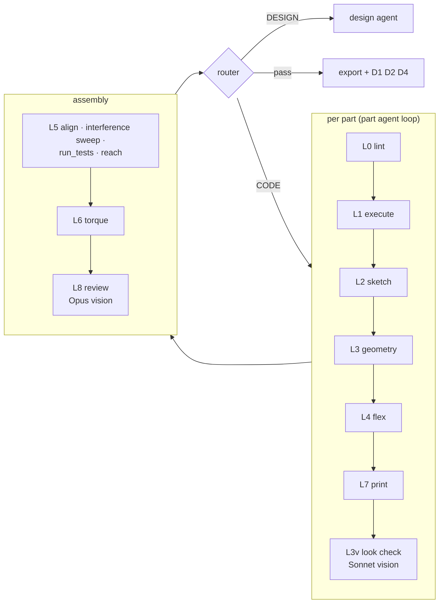
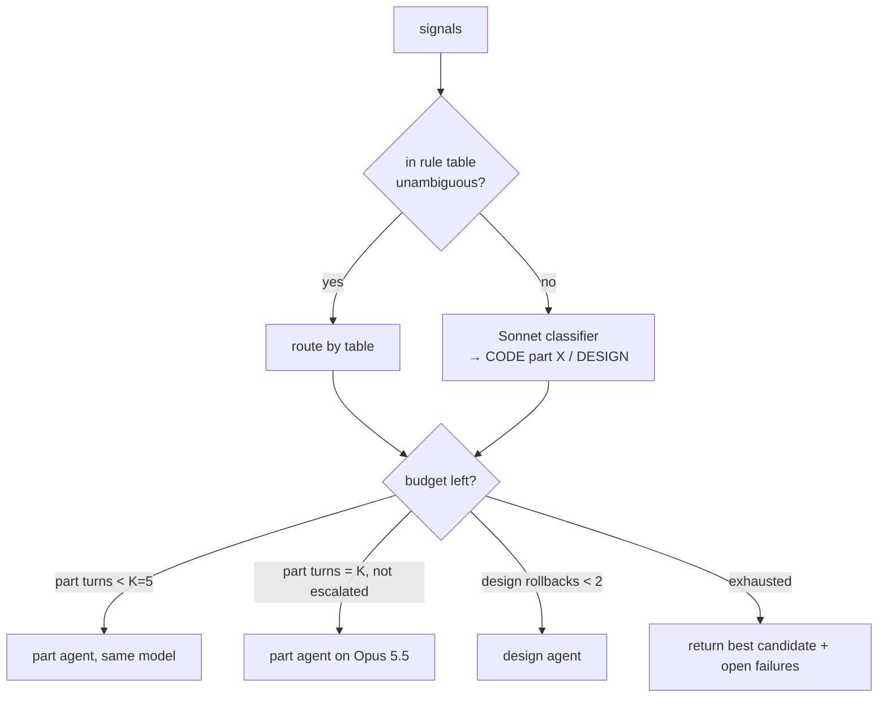

# PHASE 2 — 3-DOF arm + validation depth + benchmark v1

```yaml
id: P2
status: not_started
duration_estimate: 21 working days
depends_on: [P1 exit]
blocks: [P3]
plan_refs: [§1.4, §1.5, §4.1 L3v L4 L7 L8, §4.2, §4.4, §6.2, §6.4 P2]
goal: 3-DOF arm (200 mm, 50 g) passing every gate incl. flex test, full print gate and visual review; 30-prompt benchmark across 2 packs; model-routing comparison
```

## 0. Previous phase (P1) — keep in mind
- Pipeline exists end-to-end; don't restructure it. P2 adds gates, the LLM router layer, renders and the mechanisms pack.
- Params already have `min/max` (schema). Router is a `gate → CODE|DESIGN` table. `render_part` is a stub.
- Read P1 bench results: most-misused SDK calls and most frequent failing gates drive SDK v1 changes (T2.1).
- Plan-level L6 used rod estimates (0.5 g/mm); compare against real printed masses from P1 runs and recalibrate.

## 1. Scope

| In | Out |
|---|---|
| 3-DOF (yaw, shoulder, elbow), bearing-supported shoulder (`servo_u_bracket` + 608ZZ/623ZZ) | wrist, gripper, ROS 2 package (P3) |
| L3v, L4, L7-full, L8, LLM-assisted router, model escalation, budgets | memory / experience store (P4) |
| Mechanisms pack v0 (hinge, slide, drawer, gear pair, latch composites + knowledge) | enclosures pack (P4) |
| Benchmark v1 (30 prompts), 3 model configs | CI regression gating (P5) |
| Optional physical print of best 3-DOF (print service) | — |

## 2. Validation pipeline after P2


Order rule: deterministic gates first; vision gates only on candidates that already pass them. Vision can add issues, never override a deterministic pass/fail.

## 3. Specs

### 3.1 L4 flex test
- For each top-level param `p` with range `[min, max]`: recompute at `min`, `max`, and one random interior value (seeded by job id). Max 3 × n_params recomputes; cap 30 per part (prioritise params referenced by connectors).
- Pass: no recompute error; all sketches DoF = 0; L3 still passes; connectors still resolve. Then restore nominal.
- Failure signal names the param and the first broken feature. Range conflict across parts → DESIGN.

### 3.2 L5 extensions
- Interference sweep: per joint 9 samples; combined grid capped at 125 poses (Latin hypercube beyond 3 joints). Report min clearance per part pair.
- `run_tests(ctx)` authored by the design agent: `expect_contact`, `expect_clearance(over_joint, samples)`, `expect_reach`, `allow_overlap(reason)` (Articraft helpers, Apache-2.0, attribution in NOTICE).

### 3.3 L7-full print gate (against active profile, plan §4.2)

| Check | Method | Fail → |
|---|---|---|
| Orientation | candidates: 6 axis-aligned + largest planar face down; score = support area + λ·(load-path ⟂ layers penalty, from connector labels) | pick best; record in `print_report.json` |
| Build volume | oriented bbox ≤ profile volume | DESIGN: split part (dovetail or screw joint composite) |
| Overhang / bridge | face normals vs. 45°; bridge length ≤ 10 mm | CODE (add chamfer, change orientation) |
| Min wall / feature | ray-cast thickness ≥ `min_wall` | CODE |
| Fits | probe hole diameters vs. `fit` table | CODE |
| Manifold | trimesh + manifold3d | CODE |
| Slicer (optional) | PrusaSlicer/OrcaSlicer CLI as external exe; slices; filament mass | warning only; mass replaces shell+infill estimate |

### 3.4 L3v and L8 (vision)
- Renderer: PyVista offscreen; fixed camera set (iso ×2, front, top), connector frames as RGB axes, neutral material, 768 px.
- L3v input: 4 renders + part intent + connector list → Sonnet 5.5 → `{matches_intent: bool, issues: [{severity, where, what}]}`. Max 2 rounds; persistent disagreement ⇒ warning.
- L8 input: 4 assembly renders + **GIF per actuated joint** (12 frames over limits) + **bbox table** (`part, link, size_mm, center_mm`) + gate reports → Opus 5.5 → `{geometry:1-5, detail:1-5, motion:1-5, issues:[…], route_hint: CODE|DESIGN}`.
- If GIFs are not accepted as input by the backend, send keyframes (4 per joint) as images.

### 3.5 Router v2 and budgets


- CODE repair = keep/regenerate split (ArtiCAD §4.5): only failing parts regenerate.

### 3.6 SDK v1 additions (target ≈ 30 calls)
`fillet/chamfer(edges=<named feature edges>)` (by feature tag, not face index — TNP), `boss`, `rib`, `shell`, `mirror_feature`, `pattern_linear/polar`, `bearing_seat(card)`, `horn_coupler(card)`, `turntable_base(servo, bearing)`, `link_bar`, `hollow_link(cable_channel=True)`, `split(part, by="dovetail"|"screws")`. Every new call: unit test asserting DoF = 0 + L4 flex on a sample.

## 4. Bench v1 (30 prompts)

| Slice | n | Examples |
|---|---|---|
| Manipulator 2-DOF | 8 | P1 set + variations of reach, base shape |
| Manipulator 3-DOF | 12 | 200 mm / 50 g target; different link styles; bay placement; named boards |
| Mechanisms pack | 8 | hinged box, drawer, linear slide, gear pair, latch, lamp arm (passive), metronome (ArtiCAD), folding tablet stand |
| Core-only (no pack) | 2 | phone stand with hinged leg, sliding lid box |

Configs: `sonnet_only`, `opus_only`, `routed` (plan §2.3). Report per slice: success, DoF-0, flex pass, torque-margin pass, print pass, iterations, tokens, cost, time. Subscription limits may throttle: run slices across days or move bench to an API key.

## 5. Task list

| ID | Task | Depends |
|---|---|---|
| T2.1 | SDK v1 + tests; fix top P1 misuse patterns | P1 data |
| T2.2 | L4 flex test | T2.1 |
| T2.3 | L5 sweep + `run_tests` helpers | — |
| T2.4 | L7-full (+ optional slicer wrapper) | — |
| T2.5 | Renderer + `render_part` tool; L3v | — |
| T2.6 | L8 review (GIF/keyframes, bbox table) | T2.5 |
| T2.7 | Router v2, escalation, budgets, best-candidate return | T2.6 |
| T2.8 | Mechanisms pack v0 | T2.1 |
| T2.9 | 3-DOF golden (hand-written) solution | T2.1–T2.4 |
| T2.10 | Bench v1 + 3 configs + report | all |
| T2.11 | Recalibrate plan-level L6 densities from real masses | P1 data |

## 6. Exit criteria
- [ ] 3-DOF golden passes all gates at 200 mm / 50 g.
- [ ] Bench v1 `routed`: ≥ 70 % success manipulator slices, ≥ 60 % mechanisms + core-only (initial bar; tune after first run).
- [ ] L4 pass rate reported; no accepted part fails L4.
- [ ] Routing decision made (keep `routed` or change defaults) with cost numbers.

## 7. Next phase (P3) — prepare for
- P3 needs **coupled joints** (gripper) → confirm whether Assembly WB `Gears`/`RackPinion` work headless (extra spike in P3 week 1) or store coupling as metadata only.
- Exporter must switch to multi-file ROS 2 package → keep exporter outputs path-agnostic (`package://` prefix injected at the end).
- Collect L8 issues that deterministic gates missed → candidates for new deterministic checks.
- R7 (print-readiness tools) and R8 (hobby-arm design) deep research: ask user if L7/L6 results look weak.
