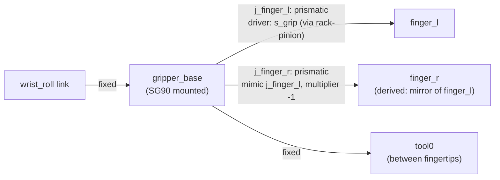
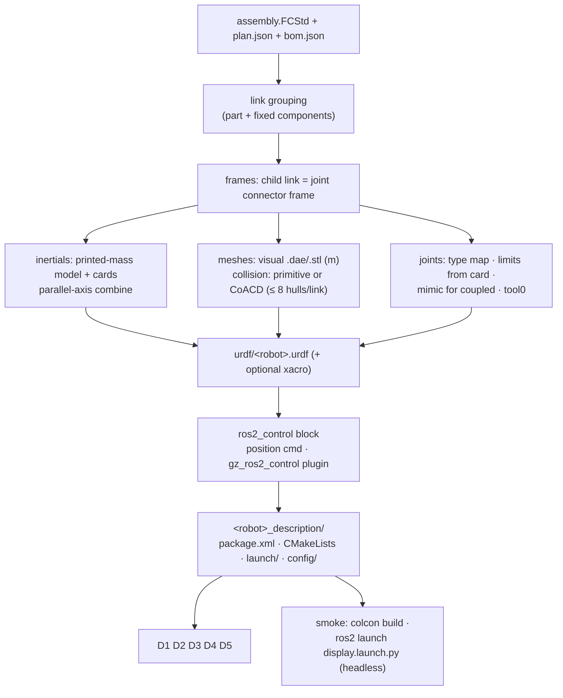

# PHASE 3 — 4–5 DOF: wrist, gripper, ROS 2 description package

```yaml
id: P3
status: not_started
duration_estimate: 28 working days
depends_on: [P2 exit]
blocks: [P4]
plan_refs: [§3.2 coupled/derived, §3.6 cards, §5 (all), §6.2 Q12, §6.3 R5 R6, §6.4 P3]
goal: 4–5 DOF arm with MG90S wrist and SG90 parallel gripper; complete ROS 2 description package (ros2_control, Gazebo-ready) passing D1–D5 and a colcon/RViz smoke test
```

## 0. Previous phase (P2) — keep in mind
- All gates L0–L8 exist; P3 adds no new L-gates, only D3 (full) and D5.
- Router v2 + budgets fixed. Routing defaults chosen from bench v1 — use them.
- Exporter writes path-agnostic outputs; `package://` prefix is injected at package build.
- Week-1 spike needed: Assembly WB `Gears` / `RackPinion` headless (see §3.1).

## 1. Scope

| In | Out |
|---|---|
| Wrist pitch (MG996R or MG90S) + wrist roll (MG90S) | 6th DOF (P4) |
| SG90 parallel gripper, gear-coupled fingers, ≥ 40 mm opening (decision Q12) | tool flange variant (optional, P4) |
| Derived parts (mirrored fingers), coupled joints → `<mimic>` | closed loops (excluded by user) |
| `cylindrical`/`ball` decomposition (if any plan uses them) | — |
| CoACD collisions, D3 full, D5 FK cross-check | Gazebo spawn / sim (P5) |
| ROS 2 package + ros2_control + launch; colcon + RViz smoke test in Linux | MoveIt config (later) |
| Library to ~15 cards; card drafting from datasheet / STEP | — |

## 2. Gripper and coupling model


- Plan schema: `Joint.coupling = {leader: str, ratio: float, offset: float}` → URDF `<mimic joint=leader multiplier=ratio offset=offset/>`. Kinematics stays a tree; the follower is not an independent DOF (`dof` count excludes followers).
- SG90 drives a pinion; rack-pinion ratio converts servo angle → finger travel: `travel = r_pinion · θ`. Leader joint is prismatic in URDF; its `effort` = force = `τ_stall·derating / r_pinion`.
- Derived parts: `derived: [{name: finger_r, source: finger_l, transform: mirror_yz}]` → deterministic SE(3) + mirror on the compiled shape; still a parametric FreeCAD object (`PartDesign::Mirrored` or `Part::Mirroring` of the source Body — choose in spike).

## 3. Specs

### 3.1 Week-1 spike S12
- Create `Gears` and `RackPinion` joints headless (`JointObject.JointTypes` include them). Pass: solve OK and follower moves with ratio. Fail: store coupling only in plan + URDF; FreeCAD gets independent joints with a note.

### 3.2 Cards added
MG90S (`verified: false`, ~13.4 g, stall ≈ 0.18/0.22 N·m at 4.8/6 V — datasheet, verify), SG90 (~9 g, ≈ 0.18 N·m at 4.8 V), servo horns (MG996R 25T, MG90S/SG90 21T), bearings 608ZZ / 623ZZ / 6806, M2/M2.5/M3/M4 screws and nuts, M3 heat-set insert, Arduino Uno-size. Each with generator + connectors + interfaces.

### 3.3 Card drafting
- From datasheet text/PDF: Opus extracts dimensions → card YAML (`verified: false`) → generator builds envelope + interfaces → shown at checkpoint with a render.
- From user STEP: imported as fixed non-parametric envelope (`Part::Feature`, clearly labelled), connectors placed by the agent and confirmed at checkpoint.

### 3.4 Description package



| Gate | P3 detail |
|---|---|
| D3 | visual meshes watertight or exempted; collision hulls ≤ cap; units m; file size cap per mesh (e.g. 2 MB, decimate) |
| D5 | 20 random q within limits (followers via mimic): Pinocchio link poses vs. FreeCAD (Assembly solve or own FK from P0 §4). pos < 1e-5 m, rot < 1e-4 rad |
| Smoke | ROS 2 Jazzy container/WSL: `colcon build`, launch `robot_state_publisher` + `joint_state_publisher` (no GUI), check `/tf` has every link. Outside the agent loop |

- `config/ros2_controllers.yaml`: `joint_trajectory_controller` for arm joints, separate `gripper` controller (`parallel_gripper_action_controller` or position controller — pick in P3 week 3 by checking current ros2_controllers docs), `joint_state_broadcaster`.
- Compare generated layout with a RobotCAD-generated package of a similar arm (reference only; no code copy).

### 3.5 Torque at 4–5 DOF
- Bench targets: 4-DOF 220 mm / 50 g; 5-DOF 250 mm / 50 g. Expect the shoulder to fail naive designs (plan §6.2 table) → design agent must reach for: dual shoulder servos (`servos_on_axis: 2`), MG90S wrist, hollow links, shorter forearm, spring/counterweight composite (add `counterweight_mount` to manipulator pack).

## 4. Task list

| ID | Task | Depends |
|---|---|---|
| T3.1 | Spike S12 (coupled joints headless) | — |
| T3.2 | Schema: `coupling`, `derived`; DOF count excludes followers | T3.1 |
| T3.3 | Cards §3.2 + generators | — |
| T3.4 | Pack composites: `wrist_pitch_roll`, `parallel_gripper(servo, opening)`, `counterweight_mount` | T3.3 |
| T3.5 | Exporter: mimic, CoACD, xacro option, package templates, ros2_control | — |
| T3.6 | D3 full, D5 FK cross-check | T3.5 |
| T3.7 | ROS 2 smoke test container + script | T3.5 |
| T3.8 | Card drafting (datasheet, STEP) + checkpoint render | T3.3 |
| T3.9 | 5-DOF golden (hand-written) incl. gripper | T3.4 |
| T3.10 | Bench v2: +10 prompts (4–5 DOF, grippers, a mechanisms-pack gear train w/ mimic) | all |

## 5. Exit criteria
- [ ] 5-DOF golden with gripper passes L0–L8 and D1–D5; smoke test green.
- [ ] Bench v2 routed ≥ 60 % on 4–5 DOF slice; no regression > 5 pts on P2 slices.
- [ ] One drafted card (from a datasheet the user supplies) goes through checkpoint and is used in a passing job.

## 6. Next phase (P4) — prepare for
- 6th DOF adds load at the wrist → keep wrist composites light; record measured link masses per composite for plan-level L6.
- Start saving every job (pass and fail) with plan, signals, final verdict in a uniform record → P4 experience store ingests them without migration.
- Knowledge packs may be outgrowing the prompt → measure tokens per agent call; if > ~20 k for knowledge, P4 switches to retrieval.
- R5 (component libraries) and R6 (printed mass accuracy) deep research: ask user if cards or D2/L6 accuracy are the bottleneck.
