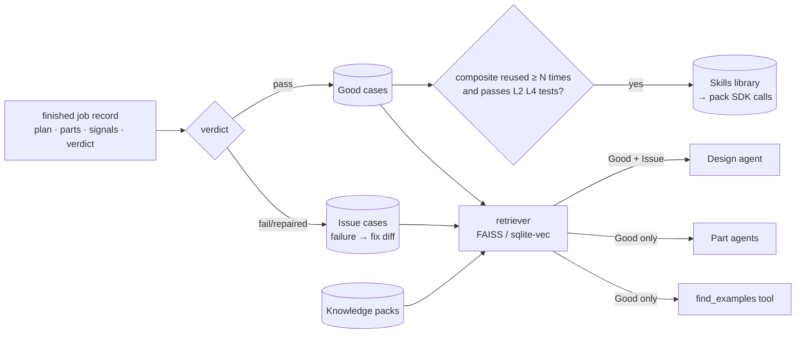
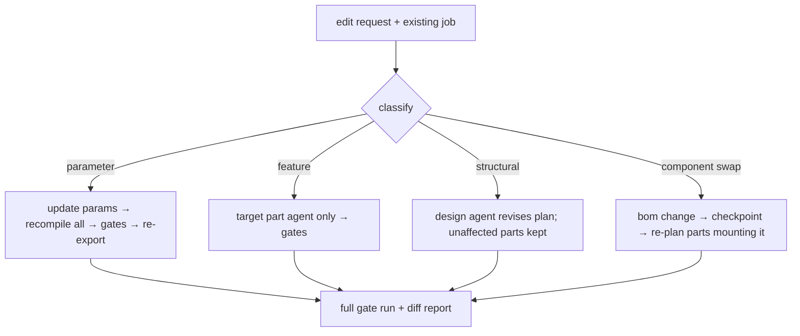

# PHASE 4 — 6-DOF goal, memory, editing, image input, third pack

```yaml
id: P4
status: not_started
duration_estimate: 28 working days
depends_on: [P3 exit]
blocks: [P5]
plan_refs: [§1.4, §3.5, §4.5, §6.2 Q11, §6.4 P4]
goal: 6-DOF arm with SG90 gripper at 250 mm / 50 g passing every gate (stretch 100 g); experience store + skills; edit sessions; image-conditioned input; a third domain pack added without touching core
```

## 0. Previous phase (P3) — keep in mind
- Gripper, wrist, coupling (`mimic`) and ROS 2 package exist and pass D1–D5 + smoke test.
- Job records are uniform (plan, signals, verdict) → ingest directly.
- Token measurements of knowledge packs decide retrieval vs. in-prompt.
- Naive designs fail shoulder torque (plan §6.2: ≈ 0.63 vs. 0.54 N·m). Mitigation composites exist (`counterweight_mount`, dual servo axis).

## 1. Scope

| In | Out |
|---|---|
| 6-DOF: yaw, shoulder, elbow, wrist pitch, wrist roll, (wrist yaw \| gripper roll) + SG90 gripper | > MG996R actuators (P5+ via new cards) |
| Experience store (Good/Issue, asymmetric retrieval) | fine-tuning |
| Skills library (composite promotion) | — |
| Edit sessions: param, feature, structural, component swap | GUI round-trip (excluded) |
| Image-conditioned requirements (reference photo/sketch) | image → exact geometry reconstruction |
| Third pack (enclosures) to prove pack isolation | — |

## 2. Memory architecture


- Key = embedding of (spec summary + part intent + pack). Store code + plan excerpt + signals. Dedupe by plan hash.
- Promotion: candidate composite → human review once → added to pack with tests (DoF = 0, L4). Promotion to *core* only if ≥ 2 packs use it (plan §1.4).
- Ablation required: bench with and without memory (ArtiCAD saw 4.4 → 3.1 iterations).

## 3. Edit sessions (plan §3.5)


- Each edit creates a new job version (`jobs/<id>/v<n>/`), diffed against the previous (params, parts, URDF).
- Parameter edits must not invoke any LLM (deterministic recompile); measures true parametricity.

## 4. 6-DOF targets and checks
- Target: 250 mm reach, 50 g, all joints ≤ stall × 0.5 (×servos_on_axis). Stretch: 100 g at max passing reach.
- Report per joint: worst-case τ, margin %, pose. Report states assumptions (derating, printed-mass model, material).
- Power note: 6 × MG996R-class stall ≈ 15 A worst case (approx) → external supply recommendation in report.
- Electronics bay must still fit (generic or named boards) and pass interference over sweep.

## 5. Image input
- Requirements agent accepts 1–3 images (photo or sketch) + text. Output stays `spec.json` (+ `style_notes`, proportion hints). No geometry is read off the image directly.
- Bench: 5 image-conditioned prompts (manipulator + mechanisms).

## 6. Task list

| ID | Task | Depends |
|---|---|---|
| T4.1 | 6-DOF golden (hand-written) at 250 mm / 50 g | P3 composites |
| T4.2 | Experience store + retriever + `find_examples` backed by it | job records |
| T4.3 | Skills promotion workflow | T4.2 |
| T4.4 | Edit sessions (4 types) + versioning + diff report | — |
| T4.5 | Image-conditioned requirements | — |
| T4.6 | Enclosures pack v0 (snap fits, PCB housings, cable glands) — **no core changes allowed** | — |
| T4.7 | Bench v3: +6-DOF slice, +edit tasks, +image prompts, +enclosures slice; memory ablation | all |

## 7. Exit criteria
- [ ] ≥ 1 agent-generated 6-DOF design passes every gate at 250 mm / 50 g (≥ 3 of 10 runs).
- [ ] Memory ablation shows fewer iterations or higher success (report either way).
- [ ] Parameter edits: 100 % pass without LLM calls on the edit set.
- [ ] Enclosures pack added with zero diff in `sdk/` core and `agents/` (pack-isolation proof).

## 8. Next phase (P5) — prepare for
- Move bench + production traffic to an API key before any external user; measure cost per design per pack.
- List every place that runs generated code → sandbox boundary inventory for P5.
- Collect failure classes that need physics (sagging links, servo stall in motion) → justify Gazebo / MuJoCo / FEM gates.
