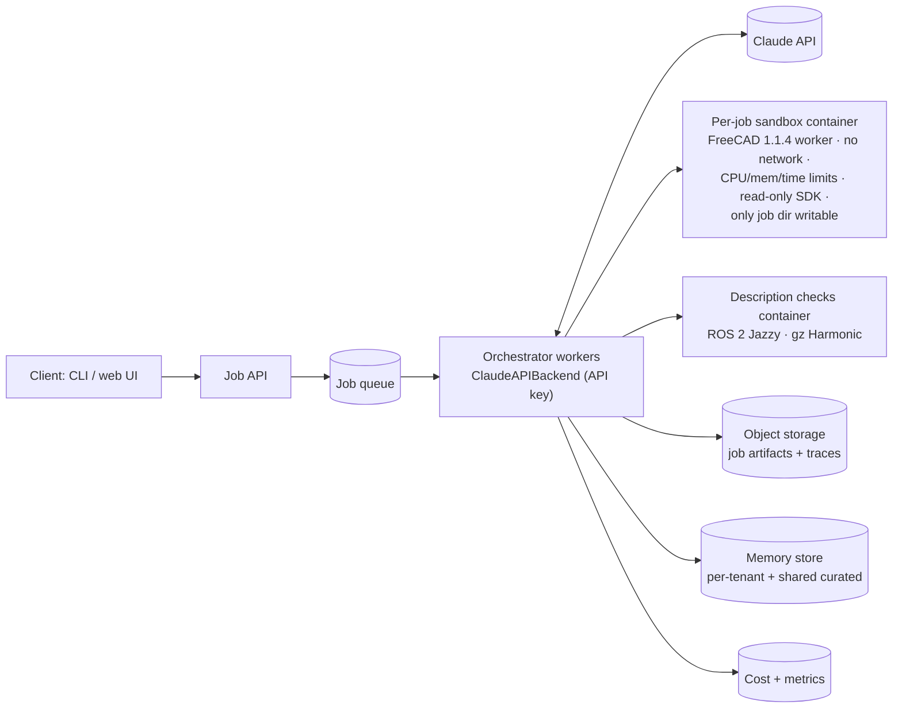

# PHASE 5 — Product hardening

```yaml
id: P5
status: not_started
duration_estimate: 35 working days
depends_on: [P4 exit]
blocks: []
plan_refs: [§2.3, §2.4, §5.6, §6.1 risks 9-13, §6.4 P5]
goal: system safe and economical to run for external users: API-key backend, sandboxed execution, cost accounting, regression CI, optional physics gates
```

## 0. Previous phase (P4) — keep in mind
- Functionality is complete for the benchmark (6-DOF + 2 other packs, memory, edits, images). P5 changes *how* it runs, not *what* it generates.
- Sandbox inventory and cost-per-design numbers come from P4 §8.
- Prototype ran on the user's Claude subscription (allowed for individual R&D only). **Nothing customer-facing before T5.1.**

## 1. Target deployment



## 2. Workstreams

| ID | Workstream | Details | Done when |
|---|---|---|---|
| T5.1 | LLM backend switch | `ClaudeAPIBackend` default; API key via secrets manager; Agent SDK backend kept for dev only. Re-read Anthropic commercial terms; confirm model with Anthropic sales | product path has no subscription auth |
| T5.2 | Sandboxing | container per job; seccomp/no-net; generated code never runs in orchestrator; L0 lint stays but isn't the boundary | pen-test checklist passes (escape attempts from `parts/*.py`) |
| T5.3 | Multi-tenant isolation | per-tenant job dirs, memory partitions (tenant Issue/Good cases never leak to others; shared library curated only) | isolation tests |
| T5.4 | Cost accounting | tokens + $ per job, per agent, per pack; budget caps per job; prompt caching for SDK reference + knowledge packs | dashboard + caps enforced |
| T5.5 | Regression CI | bench subset on every release; block if success, DoF-0, flex, torque-margin or print rates drop | CI job green on main |
| T5.6 | License audit | `pip-licenses` in CI; NOTICE (Articraft Apache-2.0); GPL/AGPL tools only as separate executables; no vendor CAD in cards | audit report clean |
| T5.7 | Physics gates (optional) | Gazebo spawn + ros2_control gravity hold test; MuJoCo stability gate; FEM (FreeCAD FEM + CalculiX subprocess) on highest-stress link | each produces structured signals through the router |
| T5.8 | Reports & disclaimers | report states assumptions (derating, mass model, material, unverified cards); URDF dynamics marked as estimates | template reviewed |
| T5.9 | UX | web checkpoint (BOM, joint tree, torque, profile), job progress, artifact download, edit requests | usability test with 3 users |

## 3. Exit criteria
- [ ] External user can run a job end-to-end on the API-key backend in a sandbox, with cost shown.
- [ ] CI regression gate active.
- [ ] License audit clean; NOTICE complete.
- [ ] At least one physics gate (Gazebo hold test) running as an optional gate.

## 4. Next (post-P5) — candidates
- Stronger actuators (smart serial servos, BLDC + gearbox cards), MoveIt config generation, more packs (grippers, legged robots, fixtures), non-FDM process profiles (resin, SLS), FEM-driven link sizing.
